# Guide d'utilisation de l'interface de gestion

Ce guide s'adresse aux personnes qui **suivent** les transferts de fichiers (consultation) et à celles qui **gèrent** le paramétrage et l'exploitation (administrateurs). Il explique chaque écran, chaque champ et chaque bouton, et montre **comment obtenir ce qu'on veut** : copier, déplacer, archiver, supprimer, attendre des fichiers, enchaîner des règles…

L'installation est décrite dans [10-installation](10-installation.md) ; la référence complète du paramétrage (noms des champs dans le fichier, codes de contrôle) dans [01-parametrage](01-parametrage.md) ; le fonctionnement du moteur dans [02-moteur](02-moteur.md).

> L'interface n'a pas encore été utilisée sur le serveur de production. Les écrans ont été vérifiés par des tests automatiques, **pas encore à la souris par une personne** : signaler tout écart avec ce guide.

**À propos des images.** Elles sont de **vraies fenêtres** de l'interface, remplies avec un environnement d'exemple (`production` et `recette`, dossiers `C:\Echanges\…`, compte fictif `EXPLOIT\a.martin`). Vos chemins, vos règles et vos dates seront différents. Elles sont régénérées par un script (voir [§22](#22-maintenance-de-ce-guide)) à chaque changement d'aspect de l'interface.

## Sommaire

**Prise en main**

1. [À quoi sert l'interface](#1-à-quoi-sert-linterface)
2. [Ouvrir l'interface](#2-ouvrir-linterface)
3. [L'onglet d'un environnement](#3-longlet-dun-environnement)

**Créer et modifier des règles**

4. [Avant de créer une règle : les choix à faire](#4-avant-de-créer-une-règle--les-choix-à-faire)
5. [Créer une règle pas à pas](#5-créer-une-règle-pas-à-pas)
6. [Le formulaire d'une règle, champ par champ](#6-le-formulaire-dune-règle-champ-par-champ)
7. [Obtenir tel résultat : recettes](#7-obtenir-tel-résultat--recettes)
8. [Enregistrer, activer, dupliquer, supprimer](#8-enregistrer-activer-dupliquer-supprimer)

**Vérifier, tester, comprendre**

9. [Vérifier le paramétrage](#9-vérifier-le-paramétrage)
10. [Simuler une règle](#10-simuler-une-règle)
11. [Lire l'état, le graphe des dépendances et les journaux](#11-lire-létat-le-graphe-des-dépendances-et-les-journaux)

**Exploitation**

12. [Agir sur une règle : reprise, lancement, acquittement, déblocage, livraisons incertaines, purge](#12-agir-sur-une-règle)
13. [Historique, restauration et promotion](#13-historique-restauration-et-promotion)

**Environnements et outils**

14. [Gérer les environnements](#14-gérer-les-environnements-administrateurs)
15. [Les outils](#15-les-outils)
16. [Le journal de l'interface](#16-le-journal-de-linterface)

**Aide**

17. [Que faire quand…](#17-que-faire-quand)
18. [Les messages de contrôle les plus fréquents](#18-les-messages-de-contrôle-les-plus-fréquents)
19. [Exemples complets](#19-exemples-complets)
20. [Glossaire](#20-glossaire)
21. [Ce que l'interface ne fait pas](#21-ce-que-linterface-ne-fait-pas)
22. [Maintenance de ce guide](#22-maintenance-de-ce-guide)

---

# Prise en main

## 1. À quoi sert l'interface

Le transfert lui-même est fait par le **moteur**, lancé par Jenkins toutes les 5 minutes : il copie, déplace ou archive des fichiers selon des **règles**. L'interface ne copie rien. Elle sert à :

- **voir** les règles et leur état (réussie, en erreur, en attente…) ;
- **modifier** les règles (administrateurs) ;
- **agir** quand une règle est en difficulté : la reprendre, la lancer tout de suite, acquitter une erreur, débloquer une exécution, trancher une livraison incertaine, purger les vieux journaux ;
- **comprendre** (graphe des dépendances, journaux, historique des modifications) et **réutiliser** une règle d'un environnement dans un autre.

Elle n'ouvre jamais la base de données : tout passe par les commandes du moteur, qui est la seule référence pour valider un paramétrage.

### Le vocabulaire en cinq mots

| Mot | Sens |
|---|---|
| **Environnement** | Un jeu de règles avec sa propre base et ses propres dossiers : `production`, `recette`, `preprod`… C'est **un fichier** de paramétrage (`production.jsonl`) et **un onglet** dans l'interface |
| **Règle** | Une consigne de transfert : *quels fichiers* (source, masque), *où* (cible, archive), *comment* (copie, déplacement…), *quand* (planification) et *après quoi* (dépendances) |
| **Moteur** | Le programme qui exécute les règles. Lancé par Jenkins ; il lit le paramétrage et écrit l'état dans sa base |
| **Créneau** | Un moment prévu pour lancer une règle (par exemple « 07:15 » ou « toutes les 5 minutes »). Une règle part **à son créneau**, pas avant |
| **Statut** | Le résultat de la dernière exécution d'une règle : `SUCCES`, `ERREUR`, `ATTENTE`… (§3.2) |

Un glossaire plus complet est au [§20](#20-glossaire).

### Qui peut faire quoi

| | Consultation | Administrateur |
|---|---|---|
| Voir les règles, les statuts, le graphe, les journaux | oui | oui |
| Vérifier le paramétrage, simuler une règle, lire l'historique | oui | oui |
| Ajouter, modifier, supprimer une règle ; gérer les environnements | non | oui |
| Reprise, lancer maintenant, acquitter, débloquer, trancher, purger, promouvoir | non | oui |

Le **badge** en haut à droite de la fenêtre indique votre profil : **ADMINISTRATEUR** (vert) ou **LECTURE SEULE** (orange). Il dépend de votre appartenance au groupe AD des administrateurs, lue à l'ouverture de votre session Windows. Les boutons que vous n'avez pas le droit d'utiliser sont **absents**, pas seulement grisés.

## 2. Ouvrir l'interface

Lancer `Lancer-GestionCopie.ps1 -DossierParametrage <dossier>` (ou le raccourci fourni par l'exploitation). Le dossier de paramétrage est celui qui contient les fichiers `.jsonl` : un fichier par environnement.

Trois situations particulières à l'ouverture :

- **Le dossier n'existe pas.** Un administrateur se voit proposer de le créer (Oui / Non, le chemin complet est rappelé) ; un autre compte reçoit un message qui nomme le groupe des administrateurs. Un chemin vide, invalide, qui désigne un fichier ou un dossier inaccessible donne un message clair, jamais une erreur technique.
- **Python ou le moteur configurés n'existent pas** (mode Local). L'interface les cherche (PATH, lanceur `py`, dépôt) et vous demande, en une seule question, si vous voulez les utiliser pour la session. Le fichier de configuration n'est pas modifié : corrigez `Moteur.Python` et `Moteur.Racine` dedans pour que ce soit définitif.
- **Le dossier est vide.** La fenêtre explique qu'il n'y a aucun environnement ; l'administrateur se voit proposer tout de suite de **créer le premier** ([§14](#14-gérer-les-environnements-administrateurs)), les autres sont renvoyés à un administrateur.

### La fenêtre principale

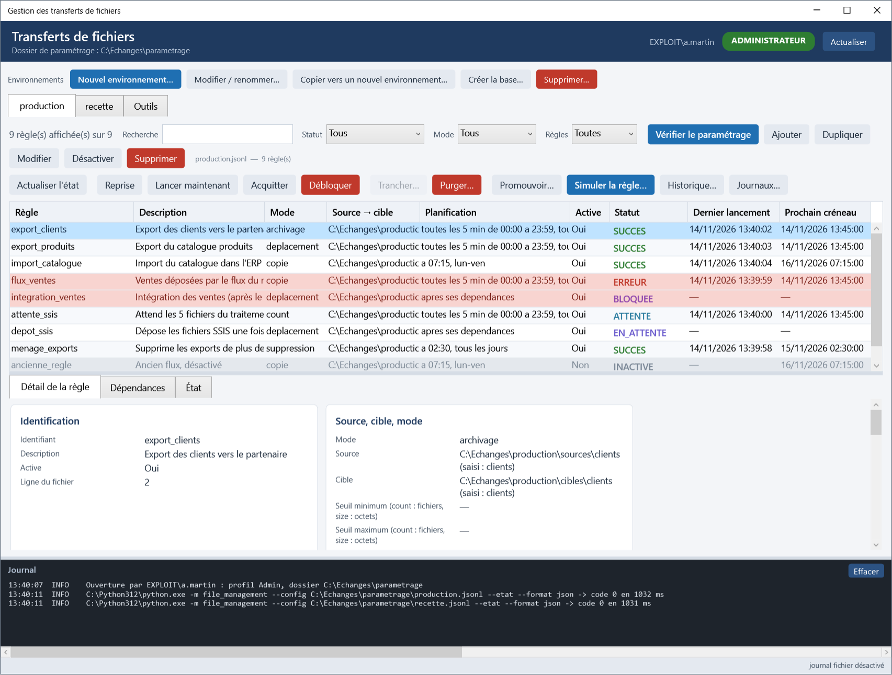

*Figure 1 : la fenêtre principale.*

De haut en bas :

1. **L'en-tête** (bleu) : le titre, le **dossier de paramétrage**, votre **compte**, le badge de profil et le bouton **Actualiser**, qui relit tout le dossier de paramétrage et reconstruit les onglets.
2. **La barre « Environnements »** (administrateurs seulement) : créer, modifier, copier, supprimer un environnement ([§14](#14-gérer-les-environnements-administrateurs)).
3. **Un onglet par environnement** (`production`, `recette`…), nommé d'après son fichier, puis l'onglet **Outils** ([§15](#15-les-outils)). Un environnement au fichier problématique (même nom déclaré deux fois, nom différent de celui du fichier, format inconnu) s'affiche en **lecture seule** avec un message dans un bandeau.
4. **Dans l'onglet** : les filtres, les boutons d'action, la **liste des règles**, puis trois onglets de détail (Détail de la règle, Dépendances, État).
5. **Le panneau « Journal »** (noir) : ce que fait l'interface (appels du moteur, enregistrements) — [§16](#16-le-journal-de-linterface). Le bouton **Effacer** le vide à l'écran.
6. **La barre d'état** : le fichier du journal de l'interface, s'il est activé.

À l'ouverture, la liste des règles s'affiche **tout de suite** ; les statuts arrivent quelques instants plus tard (message « État en cours de lecture… »). Pendant ce temps les boutons de l'onglet sont grisés.

## 3. L'onglet d'un environnement

### 3.1 La liste des règles

Une ligne par règle :

| Colonne | Contenu |
|---|---|
| **Règle** | L'identifiant |
| **Description** | Le libellé libre |
| **Mode** | `copie`, `deplacement`, `archivage`, `suppression`, `count`, `size`, `synchro` |
| **Source → cible** | Les **chemins complets** (racine de l'environnement comprise, [§14](#14-gérer-les-environnements-administrateurs)) |
| **Planification** | En clair : « toutes les 5 min de 00:00 a 23:59, tous les jours », « a 07:15, lun-ven », « apres ses dependances » |
| **Active** | Oui / Non |
| **Statut** | Le résultat de la dernière exécution, en couleur (§3.2) |
| **Dernier lancement**, **Prochain créneau** | Date de la dernière exécution et du prochain moment prévu |

**Couleurs.** Ligne **grise** : règle inactive. Ligne **rouge** : dernière exécution en erreur, règle arrêtée ou bloquée. Ligne **bleu ciel** : règle sélectionnée. Le compteur au-dessus indique « N règle(s) affichée(s) sur M ».

**Filtres.** La recherche libre cherche dans l'identifiant, la description et les chemins. Les listes **Statut** (tous les statuts du §3.2, même ceux qu'aucune règle n'a pour le moment : on peut chercher `ERREUR` ou `WARNING`), **Mode** et **Règles** (toutes, actives seulement ou inactives seulement) se combinent.

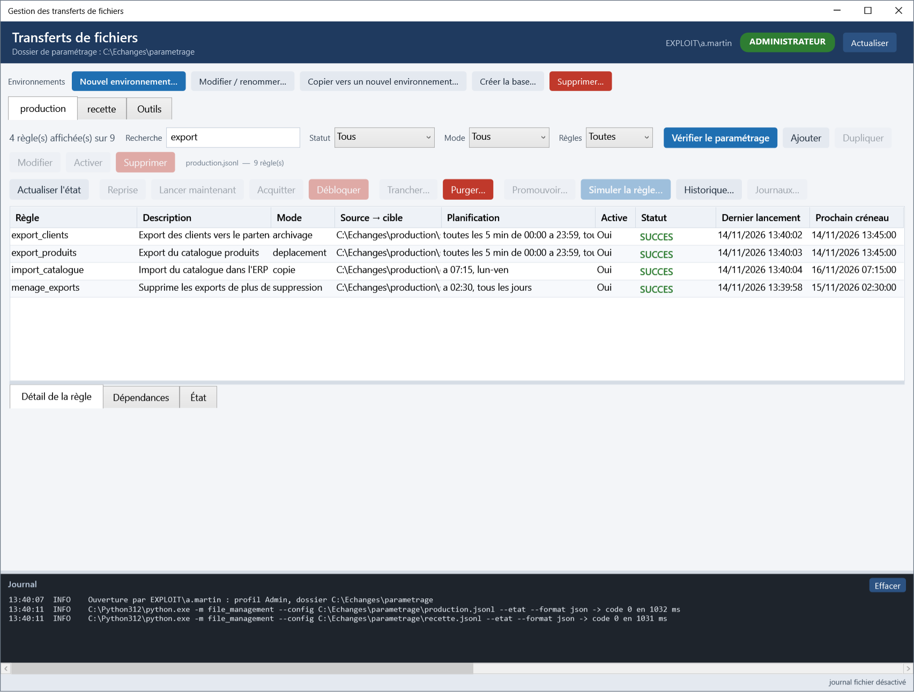

*Figure 2 : la recherche « export » ne garde que les règles dont l'identifiant, la description ou un chemin contient ce texte.*

### 3.2 Les statuts

| Statut | Sens | Que faire |
|---|---|---|
| `JAMAIS_LANCEE` | La règle n'a jamais tourné (nouvelle, ou pas encore à l'heure) | Rien ; **Lancer maintenant** pour ne pas attendre |
| `SUCCES` | Dernière exécution sans erreur ni avertissement | Rien |
| `WARNING` | Terminée avec au moins un avertissement (archive indisponible, fichier ignoré…) | Lire le motif dans l'onglet **État** et dans les **journaux** ([§11](#11-lire-létat-le-graphe-des-dépendances-et-les-journaux)) |
| `ERREUR` | Dernière exécution en erreur, ou arrêtée | [§12](#12-agir-sur-une-règle) : corriger la cause, puis **Reprise** ou **Acquitter** |
| `ATTENTE` | Règle `count` ou `size` dont les seuils ne sont pas atteints (par exemple 3 fichiers sur 5 attendus), ou règle qui attend son **fichier déclencheur** : ni succès ni erreur | Rien : les règles qui en dépendent patientent ; elle sort en succès dès que la condition est remplie |
| `ACQUITTEE` | Erreur déclarée corrigée par un administrateur | Rien |
| `EN_COURS` | Une exécution est en cours | Attendre ; **Débloquer** seulement si elle est figée |
| `EN_ATTENTE` | Son heure est passée, mais une règle dont elle dépend n'a pas encore tourné | Normal ; partira toute seule |
| `BLOQUEE` | Une règle dont elle dépend est en `ERREUR` ; le motif la nomme | Corriger la règle en erreur : toute la chaîne repart ensuite |
| `INACTIVE` | La règle est désactivée dans le paramétrage | Rien, ou **Activer** |

Ne pas confondre **`ATTENTE`** (la règle *a tourné* et constate que sa condition n'est pas remplie : seuil, témoin) et **`EN_ATTENTE`** (la règle *n'a pas pu partir* parce qu'une règle dont elle dépend n'a pas encore fini). Voir aussi le [§11](#11-lire-létat-le-graphe-des-dépendances-et-les-journaux).

### 3.3 Les onglets du bas

Les trois onglets du bas décrivent la règle sélectionnée.

- **Détail de la règle** : tous les champs de la règle, regroupés par cartes (Identification, Source / cible / mode, Sélection…). Ce sont les valeurs enregistrées dans le fichier, avec, pour les chemins partiels, le chemin complet résolu : *« D:\…\sources\clients (saisi : clients) »*.
- **Dépendances** : le graphe des règles qui s'attendent les unes les autres ([§11.2](#112-le-graphe-des-dépendances)).

  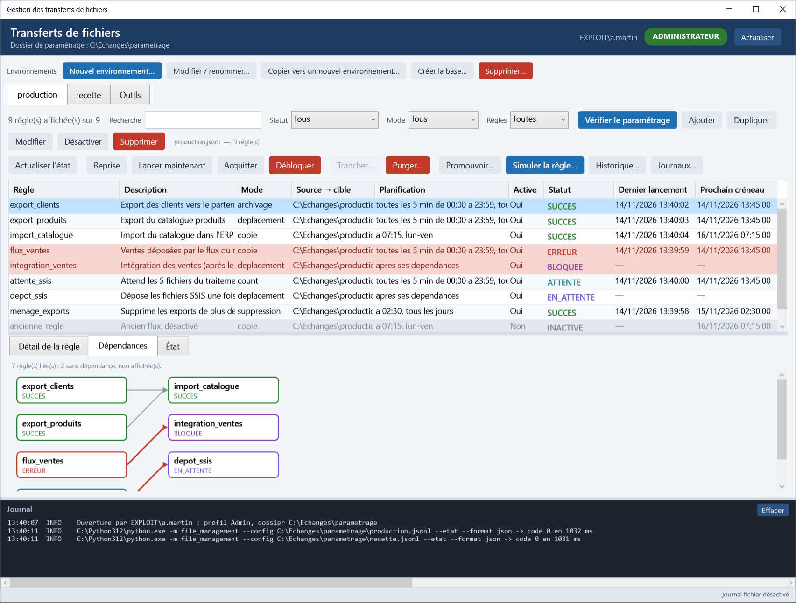

  *Figure 3 : l'onglet Dépendances.*

- **État** : statut, motif, dernière erreur, dernier succès, dernière exécution (fichiers livrés, erreurs, durée), actions en attente, livraisons incertaines, drapeaux (reprise demandée, arrêt après erreur, archivage dégradé).

  

  *Figure 4 : l'onglet État de `flux_ventes`. Le motif donne la cause (ici, le dossier source n'existe pas) ; la carte « Dernière exécution » montre 0 fichier livré et 1 erreur.*

Deux autres états typiques :

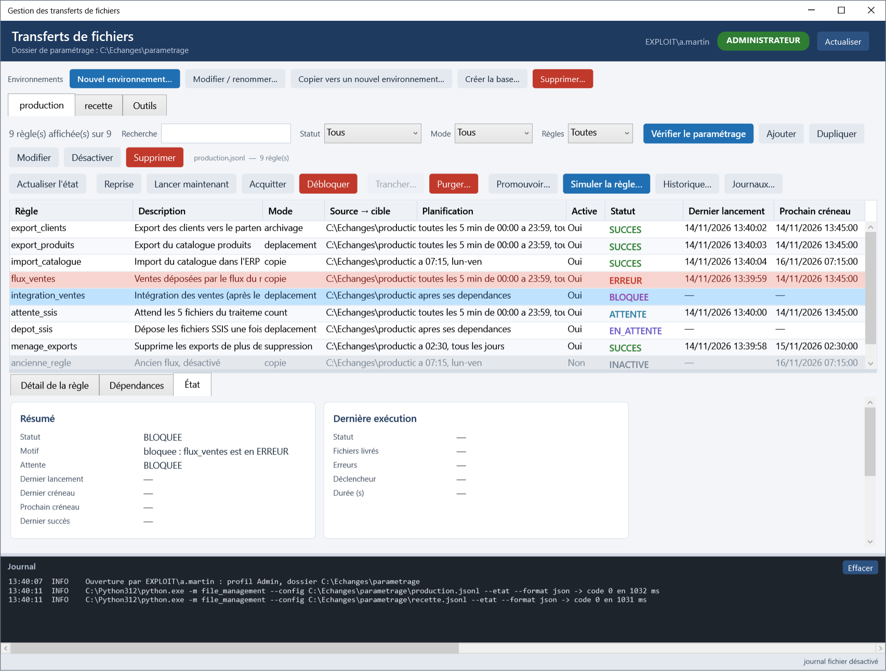

*Figure 5 : `integration_ventes` est `BLOQUEE` : le motif (« flux_ventes est en ERREUR ») désigne la règle à corriger.*

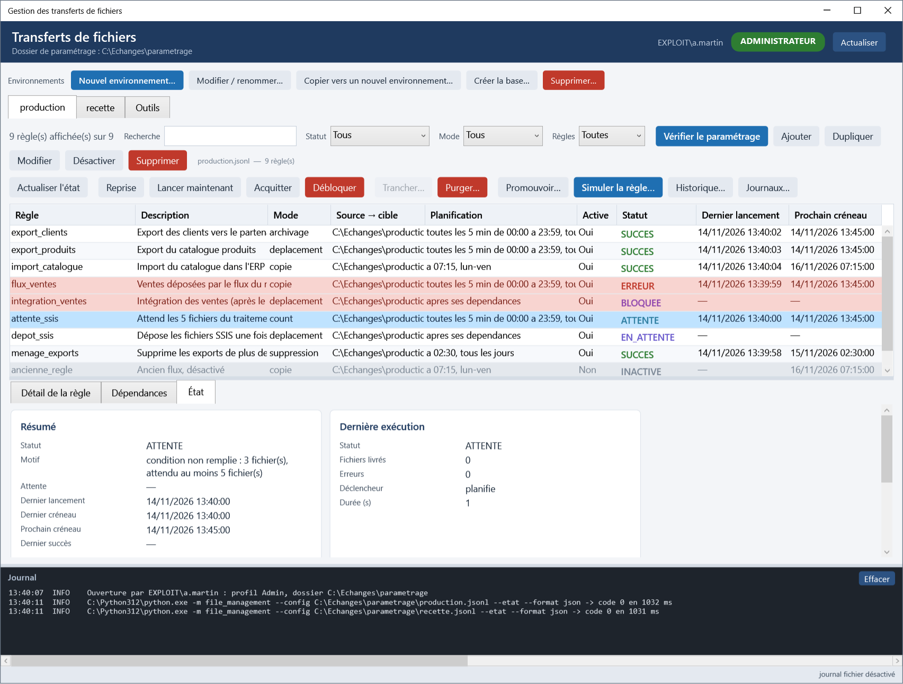

*Figure 6 : `attente_ssis` est en `ATTENTE` : « 3 fichier(s), attendu au moins 5 fichier(s) ». Ce n'est pas une erreur ; la règle `depot_ssis`, qui en dépend, est `EN_ATTENTE`.*

### 3.4 Les boutons

| Bouton | Qui | Rôle |
|---|---|---|
| **Vérifier le paramétrage** | Tous | Contrôle complet du fichier par le moteur ([§9](#9-vérifier-le-paramétrage)) |
| **Ajouter**, **Dupliquer**, **Modifier**, **Activer / Désactiver**, **Supprimer** | Administrateurs | Édition des règles ([§5](#5-créer-une-règle-pas-à-pas) à [§8](#8-enregistrer-activer-dupliquer-supprimer)) |
| **Actualiser l'état** | Tous | Relit le fichier et l'état. **Il n'y a pas d'actualisation automatique** |
| **Reprise**, **Lancer maintenant**, **Acquitter**, **Débloquer**, **Trancher…** | Administrateurs | Exploitation ([§12](#12-agir-sur-une-règle)) |
| **Purger…** | Administrateurs | Purge des journaux et archives ([§12.6](#126-purger)) |
| **Promouvoir…** | Administrateurs | Copier une règle vers un autre environnement ([§13.3](#133-promouvoir-une-règle-vers-un-autre-environnement)) |
| **Simuler la règle…** | Tous (règle sélectionnée) | Ce que la règle ferait maintenant, sans rien faire ([§10](#10-simuler-une-règle)) |
| **Historique…** | Tous (si le dossier des versions est lisible) | Modifications passées, restauration ([§13.1](#131-lire-lhistorique)) |
| **Journaux…** | Tous (règle sélectionnée) | Lire les journaux de la règle, jour par jour ([§11.3](#113-les-journaux-dune-règle)) |
| **Nouvel environnement…**, **Modifier / renommer…**, **Copier vers un nouvel environnement…**, **Créer la base…**, **Supprimer…** | Administrateurs (barre « Environnements ») | Gestion des environnements ([§14](#14-gérer-les-environnements-administrateurs)) |

Les boutons d'édition n'apparaissent que si vous êtes administrateur **et** que l'environnement n'est pas en lecture seule. Ceux d'exploitation exigent un administrateur et un fichier lisible, et (sauf Purger) une règle sélectionnée. Un bouton **grisé** signifie : aucune règle sélectionnée, un appel du moteur en cours, ou (Trancher…) pas de livraison incertaine.

---

# Créer et modifier des règles

## 4. Avant de créer une règle : les choix à faire

Une règle répond à six questions. Les réponses sont à **décider avant d'ouvrir le formulaire** ; chaque question renvoie à l'onglet du formulaire où l'on répond (§6).

| # | Question | Où répondre | Section |
|---|---|---|---|
| 1 | **Que fait-on des fichiers ?** (copier, déplacer, archiver, supprimer, compter…) | Général : *Mode* | [4.1](#41-que-fait-on-des-fichiers---le-mode) |
| 2 | **Quels fichiers ?** (dossier, masque, âge, sous-dossiers…) | Général : *Dossier source* ; Sélection | [4.2](#42-quels-fichiers---la-sélection) |
| 3 | **Où les met-on ?** (cible, archive, noms) | Général ; Anti-doublon et nommage | [4.3](#43-où-les-met-on---cible-archive-nommage) |
| 4 | **Quand ?** (toutes les N minutes, une fois par jour, après d'autres règles) | Planification | [4.4](#44-quand---la-planification) |
| 5 | **Après quoi ?** (dépendances) | Dépendances | [4.5](#45-après-quoi---les-dépendances) |
| 6 | **Et si ça se passe mal ?** (nouvel essai, délai, arrêt) | Durée et erreurs ; Situations | [4.6](#46-et-si-ça-se-passe-mal---erreurs-et-reprise) |

### 4.1 Que fait-on des fichiers ? : le mode

| Je veux… | Mode | À retenir |
|---|---|---|
| **Envoyer** les fichiers et **laisser l'original** en place | `copie` | Le moteur retient ce qu'il a déjà livré (anti-doublon) : un fichier n'est pas recopié tant qu'il ne change pas |
| **Envoyer** les fichiers et **supprimer l'original** | `deplacement` | L'original n'est supprimé qu'**après** une copie vérifiée (taille, et empreinte) |
| **Envoyer** les fichiers et **ranger l'original** dans un dossier d'archive | `archivage` | Il faut un dossier d'archive, en général daté : `.\archive\{AAAA}-{MM}-{JJ}` |
| **Faire le ménage** : supprimer de vieux fichiers | `suppression` | **Définitif.** À n'utiliser qu'avec un critère d'âge, après une simulation |
| **Attendre** qu'il y ait au moins N fichiers (ou N octets) | `count` / `size` | Ne touche à aucun fichier : sort en `ATTENTE` tant que le seuil n'est pas atteint |
| **Enchaîner** des règles, ou lancer un programme quand d'autres règles ont fini | `synchro` | Sans dossier ni heure : ne rend qu'un statut |

Aide au choix entre `copie`, `deplacement` et `archivage` : demandez-vous **ce qui doit rester dans le dossier source** après le transfert. Si le fournisseur des fichiers les efface lui-même, `copie` suffit. Si c'est à vous de vider la source, `deplacement` (rien ne reste) ou `archivage` (une copie datée reste disponible).

### 4.2 Quels fichiers ? : la sélection

- Le **dossier source** (onglet Général) et le **masque** (onglet Sélection) disent *où* et *quels noms*. `*.csv` : tous les fichiers CSV. `FACT_*.xml;FACT_*.pdf` : deux familles. **Le séparateur est le point-virgule**, jamais la virgule.
- Les **exclusions** écartent des motifs (`~*;*.tmp`).
- **Âge minimum** : à régler dès que le fournisseur écrit lui-même les fichiers dans le dossier. Un fichier modifié depuis moins de N secondes est ignoré pour ce lancement, ce qui évite de copier un fichier **en cours d'écriture**. Une à deux minutes suffisent le plus souvent.
- **Modifié depuis** (`TOUT`, `J`, `J-N`) et **âge maximum** limitent aux fichiers récents ; utile pour ne pas livrer d'anciens fichiers oubliés dans la source. Attention : la rétention de l'anti-doublon (onglet Purge) doit être **plus longue** que cette fenêtre (le moteur le contrôle).
- **Parcourir les sous-dossiers** : à cocher si les fichiers sont rangés par sous-dossier ; l'arborescence est reproduite dans la cible.
- **Limites** (nombre de fichiers, volume par lot) : pour rattraper un gros arriéré sans saturer le réseau.

### 4.3 Où les met-on ? : cible, archive, nommage

- **Dossier cible** : obligatoire pour `copie`, `deplacement`, `archivage`.
- **Chemin complet ou partiel ?** Un chemin *complet* (`D:\Echanges\clients`, `\\SERVEUR\partage\clients`) est utilisé tel quel. Un chemin *partiel* (`clients`) est placé **sous la racine de l'environnement** (voir [§14](#14-gérer-les-environnements-administrateurs)) : c'est ce qui permet de **copier un environnement** (recette → préprod) sans réécrire tous les chemins. Si l'environnement a une racine, préférez les chemins partiels ; la liste des règles montre le chemin complet résultant.
- **Archive** (mode `archivage`) : un chemin relatif (`.\archive`) se calcule **depuis la source** ; les variables de date créent un dossier par jour : `.\archive\{AAAA}-{MM}-{JJ}`.
- **Nom du fichier livré** : tel quel par défaut. Pour y ajouter la date, un modèle de renommage : `{nom}_{AAAA}{MM}{JJ}_{hh}{mm}{ss}{ext}` (voir [§6.3](#63-onglet-anti-doublon-et-nommage)).
- **Si le fichier existe déjà dans la cible** : erreur (défaut), écraser, ignorer ou ajouter un suffixe ([§6.3](#63-onglet-anti-doublon-et-nommage)).

### 4.4 Quand ? : la planification

| Je veux que la règle parte… | Type | Exemple |
|---|---|---|
| **à intervalle régulier** dans une plage horaire | `intervalle` | toutes les 5 minutes, de 05:00 à 19:00, du lundi au vendredi |
| **une fois par jour**, à heure fixe | `quotidien` | chaque jour ouvré à 07:15 |
| **dès que d'autres règles ont fini**, sans heure | `apres_dependances` | « après `flux_ventes` » |

Quelques repères :

- Le moteur est lancé **toutes les 5 minutes** par Jenkins. Une règle `intervalle` à 1 minute ne partira donc pas plus souvent qu'à chaque lancement ; l'enregistrement vous prévient (P02) si la fréquence est plus courte que la période du déclencheur.
- Un **créneau manqué** (Jenkins arrêté, règle déjà en cours) n'est rattrapé que si vous renseignez le **rattrapage** : « tant que le créneau a moins de N heures ». Sans rattrapage, il est perdu. Même si plusieurs créneaux ont été manqués, la règle ne part **qu'une fois**.
- Une **règle nouvelle** démarre à son **créneau suivant** ; pour la lancer tout de suite, **Lancer maintenant**.
- Les heures sont celles du **serveur** d'exécution.

### 4.5 Après quoi ? : les dépendances

Une règle peut attendre d'autres règles (onglet Dépendances) : *« importe le catalogue après les deux exports »*. Trois conditions, cumulables :

| Condition | La règle part si la règle amont… |
|---|---|
| `termine` | a **fini**, quel que soit le résultat |
| `succes` | a fini **sans erreur** (un `WARNING` compte comme un succès ; une règle `count` en `ATTENTE` non) |
| `fichiers` | a **livré au moins un fichier** |

Cas d'usage fréquents :

- **Chaîne simple** : B après A, condition `succes`. Si A est en erreur, B est `BLOQUEE` (et le dit) ; quand A est reprise, B part d'elle-même.
- **Attendre un lot complet** : une règle `count` (minimum 5) puis la règle de déplacement `apres` elle, condition `succes`. Voir la recette 7.5.
- **Ne rien faire s'il n'y a rien à faire** : condition `succes` + `fichiers`. Si les règles amont n'ont rien livré, la règle ne part pas.
- **Faire quand même, même après un échec** : condition `termine` seule.

### 4.6 Et si ça se passe mal ? : erreurs et reprise

- **Durée maximale** (onglet Durée et erreurs) : au-delà, la règle est arrêtée (par défaut : erreur). À régler au-dessus de la durée normale, avec de la marge.
- **Après une erreur** : `arreter` (défaut) — la règle ne repart qu'après une **Reprise** ou un **Acquittement** ; `continuer` — elle repart à son créneau suivant. Pour un flux qui doit absolument arriver dans l'ordre, gardez `arreter`.
- **Situations** (onglet Situations) : pour chaque incident possible (source inaccessible, fichier verrouillé, disque plein…), combien de **tentatives**, quel **délai** entre elles, quel **niveau** (INFO, WARNING, ERREUR) et quelle **suite**. Les valeurs proposées conviennent dans la plupart des cas ([§6.7](#67-onglet-situations)).

---

## 5. Créer une règle pas à pas

**Scénario** : « Chaque soir ouvré à 18 h 30, envoyer au comptable les factures (PDF et XML) déposées dans le dossier `factures`, puis les ranger dans une archive datée. »

Les réponses du §4 : mode `archivage` ; sélection `*.pdf;*.xml` hors fichiers temporaires, âge minimum 2 minutes ; source `factures`, cible `comptabilite`, archive `.\archive\{AAAA}-{MM}-{JJ}` ; planification quotidienne à 18:30, du lundi au vendredi ; pas de dépendance.

### Étape 1 : ouvrir le formulaire

1. Cliquez sur l'onglet de l'environnement (par exemple `production`).
2. Cliquez sur **Ajouter**. Le formulaire s'ouvre avec les valeurs de secours du moteur. (Pour partir d'une règle existante, sélectionnez-la et cliquez sur **Dupliquer** : l'identifiant est proposé avec le suffixe `_copie`, à changer.)

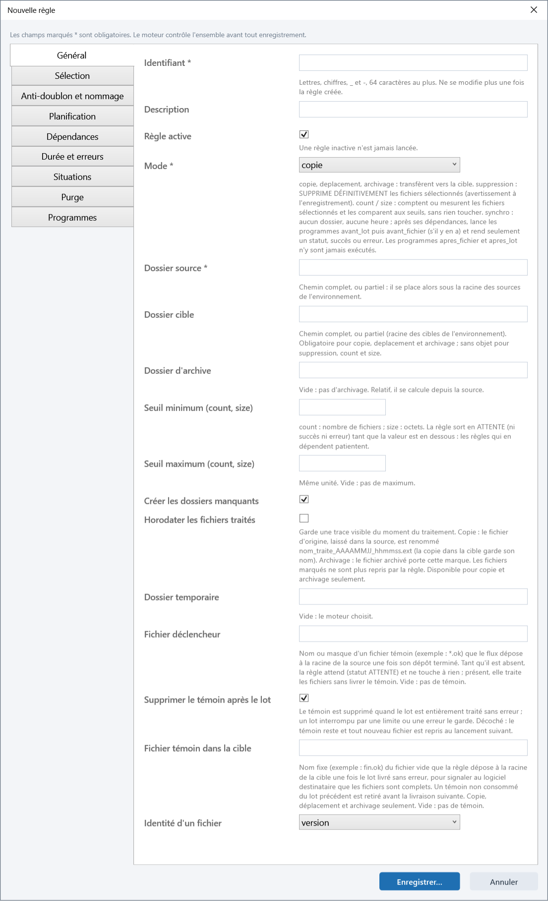

*Figure 7 : le formulaire d'une nouvelle règle. Les champs marqués d'un astérisque (*) sont obligatoires. Les onglets sont à gauche ; la zone de droite défile si besoin.*

### Étape 2 : l'onglet Général

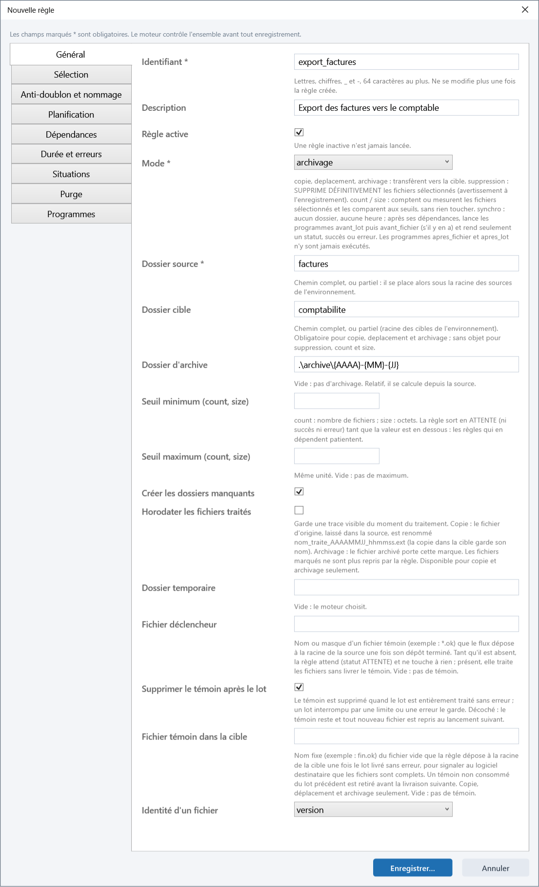

*Figure 8 : l'onglet Général rempli.*

| Champ | À saisir | Pourquoi |
|---|---|---|
| **Identifiant** | `export_factures` | Court, sans espace ni accent. **Ne pourra plus être modifié** |
| **Description** | `Export des factures vers le comptable` | Ce qu'on lira dans la liste dans un an |
| **Règle active** | cochée | Une règle inactive ne part jamais |
| **Mode** | `archivage` | Voir 4.1 |
| **Dossier source** | `factures` | Partiel : sous la racine des sources de l'environnement |
| **Dossier cible** | `comptabilite` | Partiel : sous la racine des cibles |
| **Dossier d'archive** | `.\archive\{AAAA}-{MM}-{JJ}` | Un dossier par jour, créé depuis la source |

Laissez le reste. Les champs sans objet pour le mode choisi (seuils, témoin…) sont expliqués au §6.1.

### Étape 3 : l'onglet Sélection

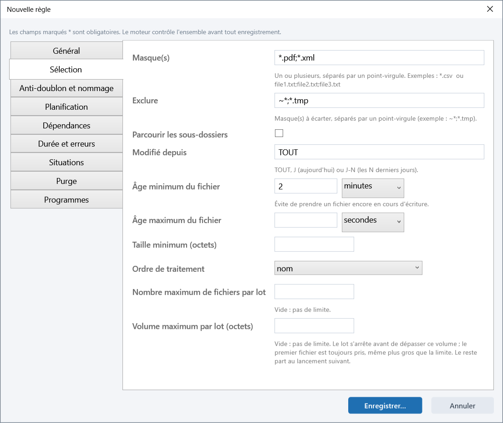

*Figure 9 : l'onglet Sélection.*

- **Masque(s)** : `*.pdf;*.xml`
- **Exclure** : `~*;*.tmp` (les fichiers temporaires que certains logiciels laissent)
- **Âge minimum du fichier** : `2` `minutes`. Le champ comprend un nombre **et une unité** (secondes, minutes, heures, jours).

### Étape 4 : l'onglet Planification

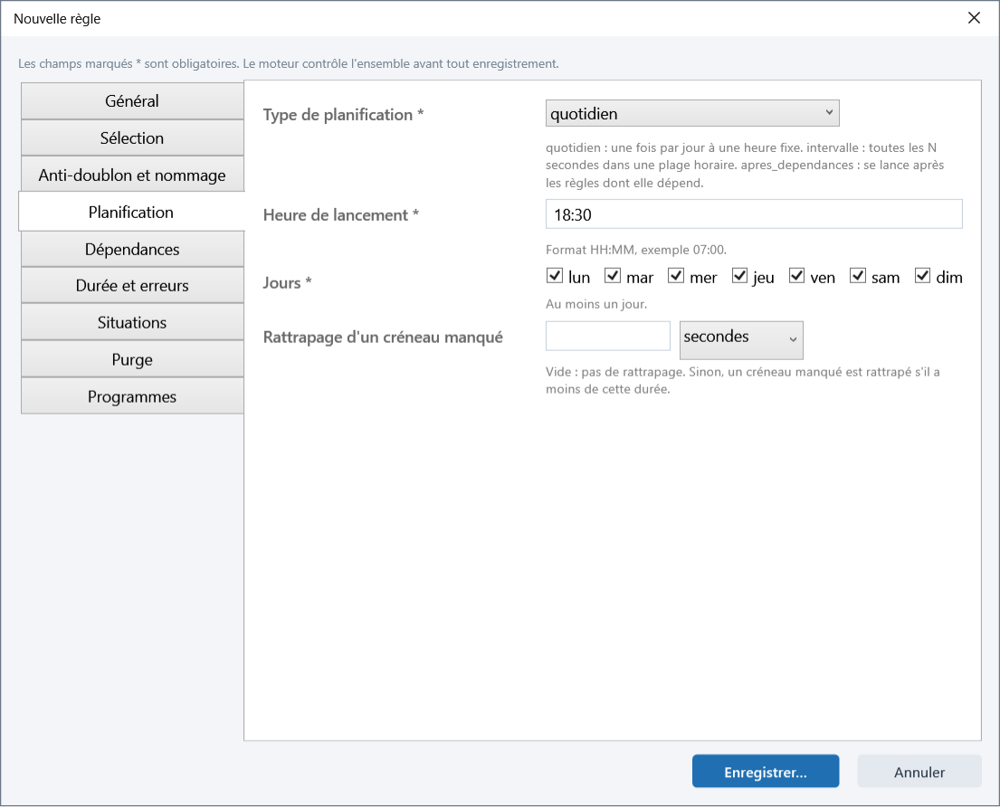

*Figure 10 : l'onglet Planification.*

- **Type de planification** : `quotidien`
- **Heure de lancement** : `18:30`
- **Jours** : décochez `sam` et `dim`
- **Rattrapage d'un créneau manqué** : `2` `heures` : si Jenkins était arrêté à 18:30, la règle part encore jusqu'à 20:30.

### Étape 5 : les autres onglets

Les **valeurs proposées** conviennent à ce scénario : dépendances vides, durée maximale 30 minutes, arrêt après erreur, situations standards, conservation de l'historique 90 jours. Passez rapidement sur chaque onglet pour vérifier qu'aucune valeur ne vous surprend ; ils sont détaillés au [§6](#6-le-formulaire-dune-règle-champ-par-champ).

### Étape 6 : enregistrer

Cliquez sur **Enregistrer…**. Il se passe, dans l'ordre :

1. **Contrôles de saisie** du formulaire (nombre invalide, heure mal écrite…) : le champ fautif est signalé, rien n'est enregistré.
2. **Le commentaire** : une fenêtre demande pourquoi vous enregistrez. Il est **obligatoire** et sera lu dans l'historique ([§13](#13-historique-restauration-et-promotion)).

   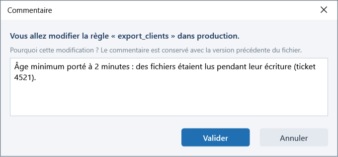

   *Figure 11 : le commentaire d'enregistrement.*

3. **La vérification du moteur.** Le fichier complet est écrit dans un brouillon et contrôlé. Un **refus** ouvre la fenêtre des diagnostics ; vous revenez au formulaire, avec votre saisie, pour corriger :

   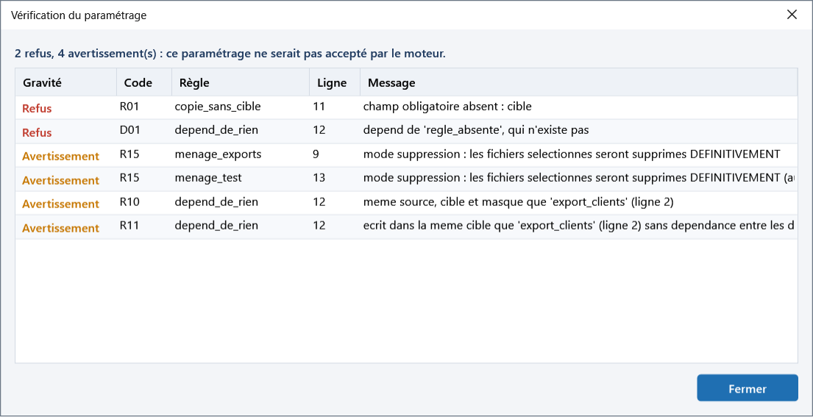

   *Figure 12 : exemple de refus. R01 : un champ obligatoire manque (ici la cible) ; D01 : la règle dépend d'une règle qui n'existe pas. Les codes sont expliqués au [§18](#18-les-messages-de-contrôle-les-plus-fréquents).*

4. **Les avertissements** (orange) vous sont soumis : lisez-les, puis choisissez d'enregistrer quand même ou de revenir corriger.
5. **L'écriture.** L'ancienne version est copiée dans `versions\` ; le fichier est remplacé en une seule opération.
6. **Le contrôle des répertoires** : l'interface vérifie aussitôt que la source, la cible, l'archive existent et sont accessibles ([§9.2](#92-contrôle-des-répertoires)).

   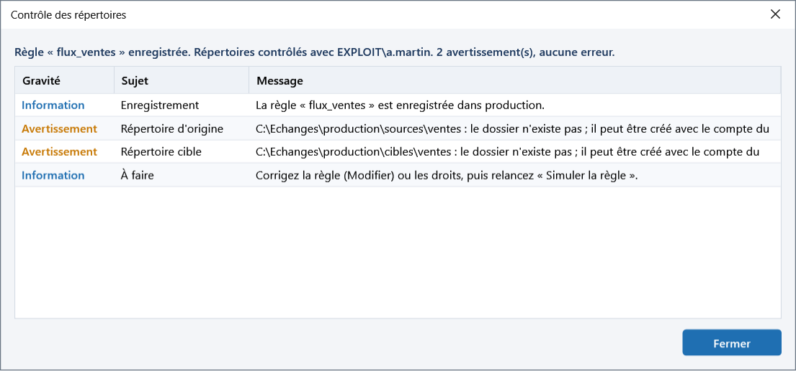

   *Figure 13 : le contrôle des répertoires. Ici, la source et la cible n'existent pas encore.*

### Étape 7 : tester avant de laisser tourner

1. **Simuler la règle…** ([§10](#10-simuler-une-règle)) : le moteur dit ce qu'il ferait **maintenant**, sans rien toucher.
2. Si le résultat est celui attendu, **Lancer maintenant** : la règle part au prochain lancement du moteur (dans les 5 minutes), sans attendre 18:30.
3. **Actualiser l'état** après quelques minutes, puis **Journaux…** ([§11.3](#113-les-journaux-dune-règle)) pour lire ce qui s'est passé.

> Une règle nouvelle **ne part pas avant son créneau suivant** : c'est normal si elle reste `JAMAIS_LANCEE` jusqu'à 18:30. C'est précisément à cela que sert **Lancer maintenant**.

### Check-list avant de quitter le formulaire

- [ ] L'identifiant est définitif (il ne se change plus).
- [ ] Le **mode** est bien celui voulu (surtout `suppression` : définitif).
- [ ] La **source** est un dossier qui existe **et** que le compte de service sait lire ; la cible est accessible en écriture.
- [ ] Le **masque** ne ramasse que les fichiers voulus (point-virgule, pas virgule).
- [ ] Un **âge minimum** est réglé si le fournisseur écrit lui-même dans la source.
- [ ] La **planification** correspond au besoin (et le rattrapage si la règle ne doit jamais être sautée).
- [ ] Les **dépendances** sont déclarées si la règle ne doit pas partir avant d'autres.
- [ ] Vous avez prévu de **simuler** avant d'activer en production.

---

## 6. Le formulaire d'une règle, champ par champ

Le formulaire est le même pour **Ajouter**, **Dupliquer** et **Modifier** ; l'identifiant n'est plus modifiable en modification. Il a neuf onglets, dans cet ordre : Général, Sélection, Anti-doublon et nommage, Planification, Dépendances, Durée et erreurs, Situations, Purge, Programmes.

Sous chaque champ, une **ligne d'aide** en gris rappelle son sens. Les durées se saisissent avec un nombre **et une unité** (secondes, minutes, heures, jours) ; les champs à valeurs fixes sont des listes déroulantes ; un champ vide qui est facultatif prend la valeur « absente ». Les contrôles de fond (existence d'une règle citée, cohérence des dates…) sont faits par le moteur à l'enregistrement.

### 6.1 Onglet Général


*Figure 14 : l'onglet Général de `export_clients` (modification : l'identifiant est grisé).*

| Champ | Sens et conseils |
|---|---|
| **Identifiant \*** | Lettres, chiffres, `_` et `-`, 64 caractères au plus ; unique (majuscules et minuscules ne comptent pas). L'historique en base y est rattaché : **ne jamais le changer**. Pour « renommer », créez une nouvelle règle et désactivez l'ancienne |
| **Description** | Libellé libre, affiché dans la liste |
| **Règle active** | Décochée : la règle n'est jamais lancée. Une règle **active** ne peut pas dépendre d'une règle **inactive** (refus D03) |
| **Mode \*** | Voir 4.1. Le formulaire propose `copie` d'office : vérifiez-le. Changer de mode grise les champs qui n'ont plus de sens |
| **Dossier source \*** | Dossier à lire. Chemin complet, ou partiel (placé sous la racine des sources). Refusé en mode `synchro` |
| **Dossier cible** | Dossier de dépôt. **Obligatoire** pour `copie`, `deplacement`, `archivage` ; sans objet pour `suppression`, `count`, `size` ; refusé pour `synchro`. Créé au lancement s'il n'existe pas, si *Créer les dossiers manquants* est cochée |
| **Dossier d'archive** | Mode `archivage` seulement (obligatoire dans ce mode). Absolu (`C:\archive`) ou relatif (`.\archive`, calculé depuis la source). Variables de date permises : `{AAAA}`, `{MM}`, `{JJ}`, `{hh}`, `{mm}`, `{ss}` |
| **Seuil minimum / maximum** | Modes `count` (nombre de fichiers) et `size` (octets) seulement. En dessous du minimum, ou au-dessus du maximum, la règle sort en `ATTENTE` |
| **Créer les dossiers manquants** | Coché (défaut) : le moteur crée la cible et l'archive au lancement s'ils n'existent pas. La **source** n'est **jamais** créée au lancement : c'est le fournisseur des fichiers qui doit l'alimenter |
| **Horodater les fichiers traités** | Modes `copie` et `archivage` : laisse une **trace du moment du traitement** dans le nom (`rapport_traite_20261111_103012.csv`). *Copie* : c'est l'original, resté dans la source, qui est renommé ; *archivage* : c'est le fichier archivé. Les fichiers marqués ne sont plus repris. Grisé pour les autres modes |
| **Dossier temporaire** | Où le moteur écrit les fichiers pendant leur copie. Vide : dans la cible, avec le suffixe `.copie_en_cours`. S'il est renseigné, il doit être **sur le même volume que la cible** |
| **Fichier déclencheur** | Nom ou masque d'un fichier **témoin** (`*.ok`) que le fournisseur dépose à la racine de la source quand il a fini. Tant qu'il est absent, la règle reste en `ATTENTE` sans rien toucher. Voir recette 7.7 |
| **Supprimer le témoin après le lot** | Coché (défaut) : le témoin est supprimé quand le lot est entièrement traité sans erreur. Décoché : il reste |
| **Fichier témoin dans la cible** | Nom **fixe** (`fin.ok`) d'un fichier vide que la règle dépose dans la cible **après** les fichiers, pour dire au logiciel destinataire que le lot est complet. Voir recette 7.8 |
| **Identité d'un fichier** | `version` (défaut) : un fichier est le même s'il a même nom, même taille, même date de modification. `contenu` : même nom et même empreinte (SHA-256) — plus sûr, plus lent |

Spécificités des modes, vues sur l'onglet Général :


*Figure 15 : mode `count` (règle `attente_ssis`) : le **Seuil minimum** est à 5, pas de cible.*

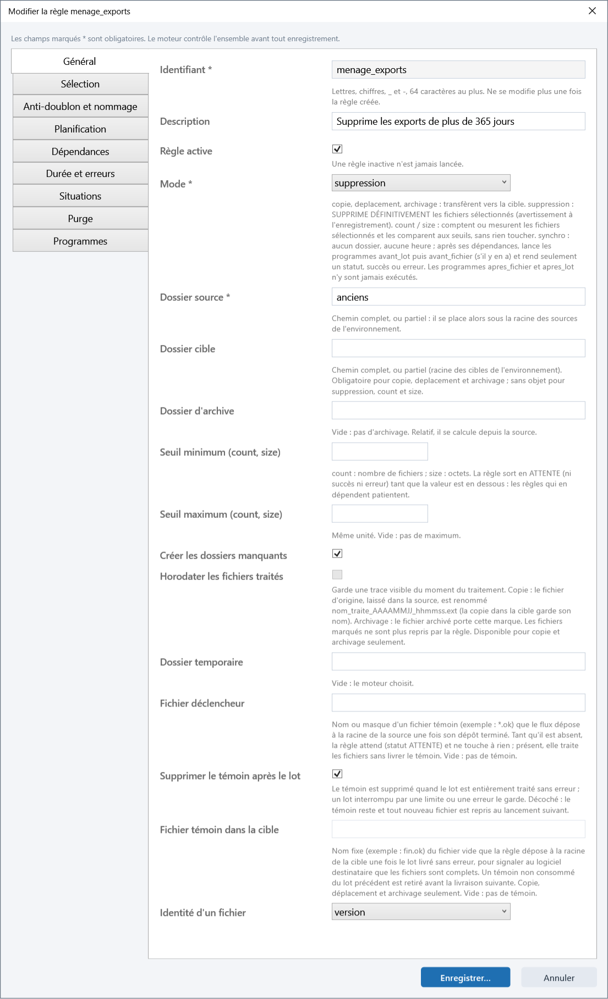

*Figure 16 : mode `suppression` (règle `menage_exports`) : pas de cible ni d'archive. L'enregistrement affiche un avertissement (R15).*

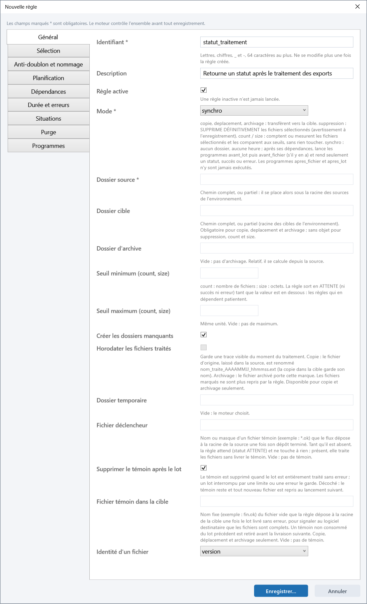

*Figure 17 : mode `synchro` : les dossiers, seuils et options de fichiers sont grisés ; il reste à remplir l'onglet Dépendances (la planification passe à `apres_dependances`).*

### 6.2 Onglet Sélection

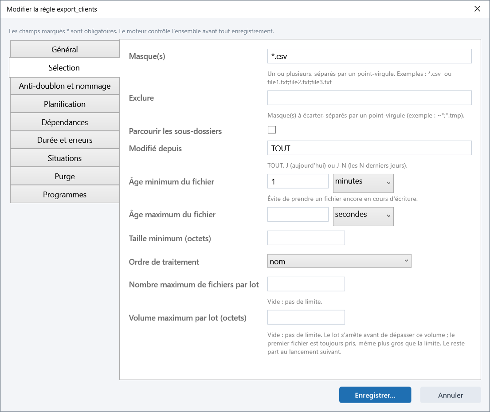

*Figure 18 : l'onglet Sélection.*

| Champ | Sens et conseils |
|---|---|
| **Masque(s)** | Un ou plusieurs motifs séparés par `;` : `*.csv`, `FACT_*.xml;FACT_*.pdf`, `file1.txt;file2.txt`. Le nom est comparé sans tenir compte de la casse. **Pas de virgule** : elle ferait partie du nom (avertissement R19) |
| **Exclure** | Motifs à écarter, même syntaxe : `~*;*.tmp` |
| **Parcourir les sous-dossiers** | Coché : tous les sous-dossiers, avec reproduction de l'arborescence dans la cible. La cible ne doit alors pas être **dans** la source (refus R03) |
| **Modifié depuis** | `TOUT` (défaut), `J` (depuis aujourd'hui 00:00) ou `J-N` (depuis il y a N jours, 00:00). Heure du serveur |
| **Âge minimum du fichier** | Ignore, pour ce lancement, les fichiers modifiés depuis **moins** de cette durée. Évite de prendre un fichier en cours d'écriture ; il sera repris à un lancement suivant |
| **Âge maximum du fichier** | Ignore les fichiers modifiés depuis **plus** de cette durée (fenêtre glissante, contrairement à `J-N` qui part de minuit). Doit être plus grand que l'âge minimum |
| **Taille minimum (octets)** | `1` exclut les fichiers vides |
| **Ordre de traitement** | `nom` (défaut) ou `date_modification` (du plus ancien au plus récent). Prenez `date_modification` si le destinataire veut les fichiers dans l'ordre d'arrivée |
| **Nombre maximum de fichiers par lot** | Plafond par exécution ; le reste est traité aux lancements suivants (rattrapage progressif). Vide : pas de limite |
| **Volume maximum par lot (octets)** | Le lot s'arrête **avant** de dépasser ce volume ; le premier fichier est toujours pris, même s'il dépasse la limite (sinon il bloquerait le flux pour toujours). Vide : pas de limite |

Le dossier d'archive est **toujours** exclu du parcours de la source. Un fichier dont la date est dans le futur de plus d'une minute est ignoré et signalé.

### 6.3 Onglet Anti-doublon et nommage

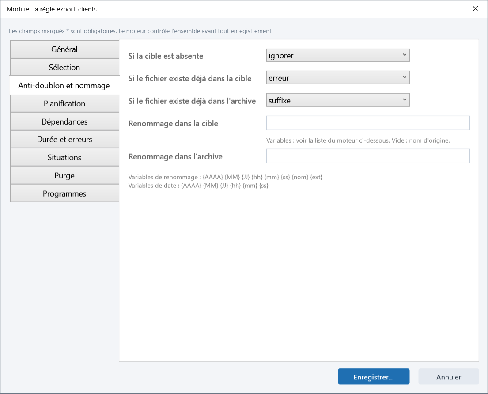

*Figure 19 : l'onglet Anti-doublon et nommage.*

Le moteur mémorise ce qu'il a livré : un fichier de même **version** (ou de même contenu) n'est pas livré deux fois. Les champs règlent ce qui se passe quand un fichier existe déjà.

| Champ | Valeurs | Sens |
|---|---|---|
| **Si la cible est absente** | `ignorer` (défaut) / `recopier` | *Mode `copie`.* Le fichier a déjà été livré, mais la copie a disparu de la cible. `ignorer` : le destinataire l'a pris, on n'y touche pas. `recopier` : on le livre de nouveau (**synchronisation**) |
| **Si le fichier existe déjà dans la cible** | `erreur` (défaut) / `ecraser` / `ignorer` / `suffixe` | Un fichier **du même nom** attend dans la cible. `erreur` : situation `fichier_existe_cible` (voir Situations). `ecraser` : remplace. `ignorer` : ne livre pas. `suffixe` : livre sous un nom horodaté |
| **Si le fichier existe déjà dans l'archive** | `suffixe` (défaut) / `ecraser` / `erreur` | Même cas côté archive |
| **Renommage dans la cible** | modèle ou vide | Nom donné au fichier déposé. Vide : nom d'origine |
| **Renommage dans l'archive** | modèle ou vide | Nom du fichier rangé dans l'archive |

**Modèles de nom.** `{nom}` : nom **sans** extension ; `{ext}` : extension **avec** le point ; `{AAAA}`, `{MM}`, `{JJ}`, `{hh}`, `{mm}`, `{ss}` : année, mois, jour, heure, minute, seconde du **début du lancement** (la même pour tous les fichiers d'un lancement). Exemple : `{nom}_{AAAA}{MM}{JJ}{ext}` transforme `export.csv` en `export_20261111.csv`. Une variable inconnue est signalée (R12) ; un modèle qui produit un nom invalide pour Windows donne une erreur à l'exécution.

### 6.4 Onglet Planification

Le premier champ, **Type de planification**, change les champs suivants.

**`intervalle`** : à intervalle régulier dans une plage horaire.

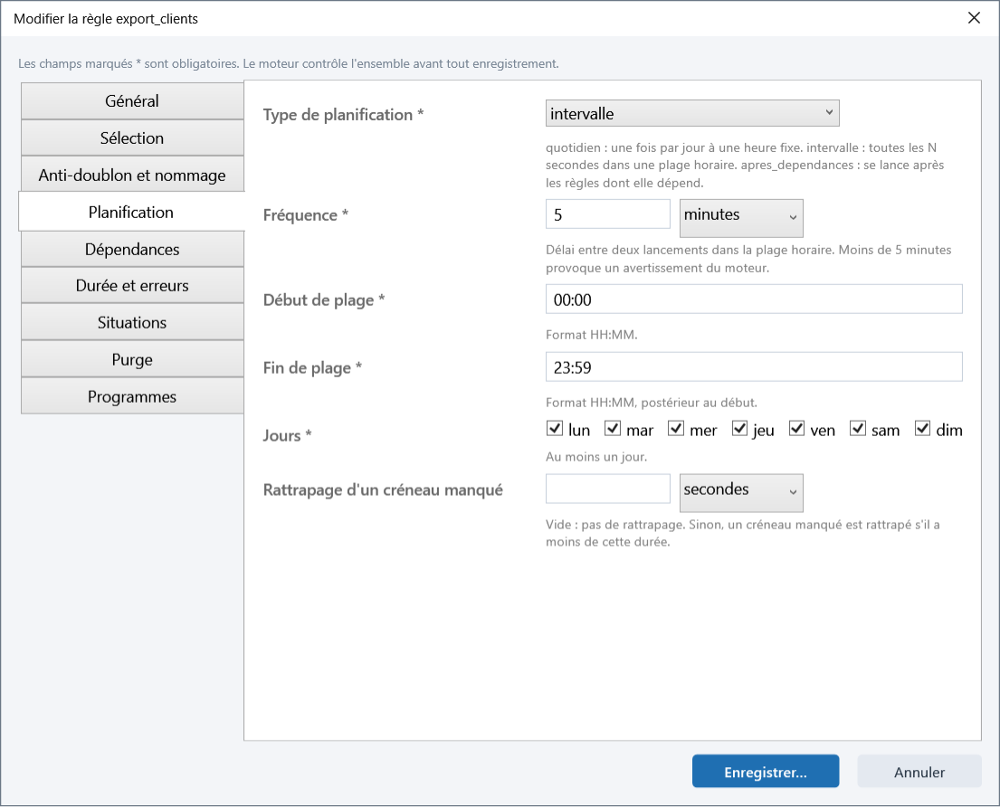

*Figure 20 : `intervalle` : toutes les 5 minutes, de 00:00 à 23:59, tous les jours.*

| Champ | Sens |
|---|---|
| **Fréquence \*** | Délai entre deux lancements (nombre + unité). Moins de 5 minutes provoque un avertissement : le moteur n'est lancé que toutes les 5 minutes |
| **Début de plage \*, Fin de plage \*** | `HH:MM`. Les créneaux sont `début`, `début + fréquence`, … jusqu'à `fin` **inclus**. `début` doit être avant `fin` |
| **Jours \*** | Cases `lun` à `dim` ; au moins un |
| **Rattrapage d'un créneau manqué** | Voir ci-dessous. Vide : pas de rattrapage |

**`quotidien`** : une fois par jour à heure fixe.

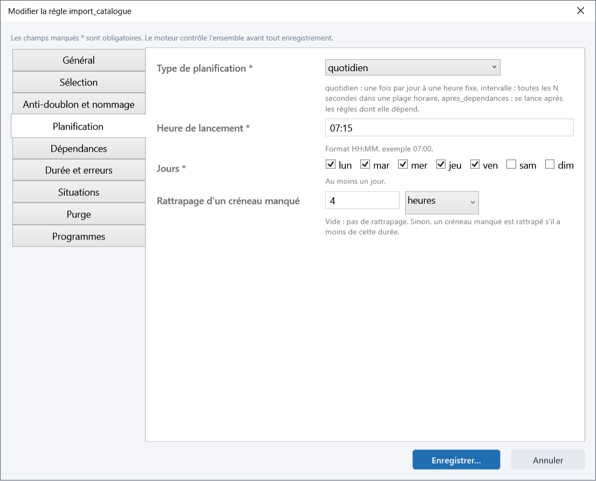

*Figure 21 : `quotidien` : à 07:15, du lundi au vendredi, avec un rattrapage de 4 heures.*

| Champ | Sens |
|---|---|
| **Heure de lancement \*** | `HH:MM` (heure du serveur) |
| **Jours \*** | Les jours où la règle part |
| **Rattrapage d'un créneau manqué** | Si Jenkins était arrêté ou la règle déjà en cours à l'heure prévue, elle part dès que possible **si le créneau a moins de cette durée**. Sinon le créneau est perdu. Plusieurs créneaux manqués donnent **un seul** départ |

**`apres_dependances`** : pas d'heure, la règle part quand ses dépendances sont remplies.

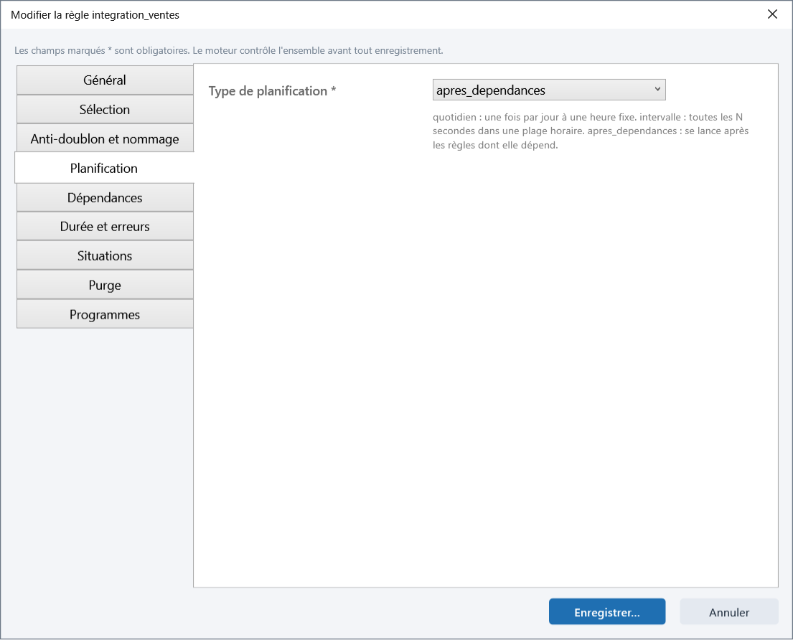

*Figure 22 : `apres_dependances` : aucun champ ; il faut renseigner l'onglet Dépendances.*

La planification est **obligatoire**. Une règle qui n'a pas d'heure doit avoir une liste de dépendances (refus D06 sinon).

### 6.5 Onglet Dépendances

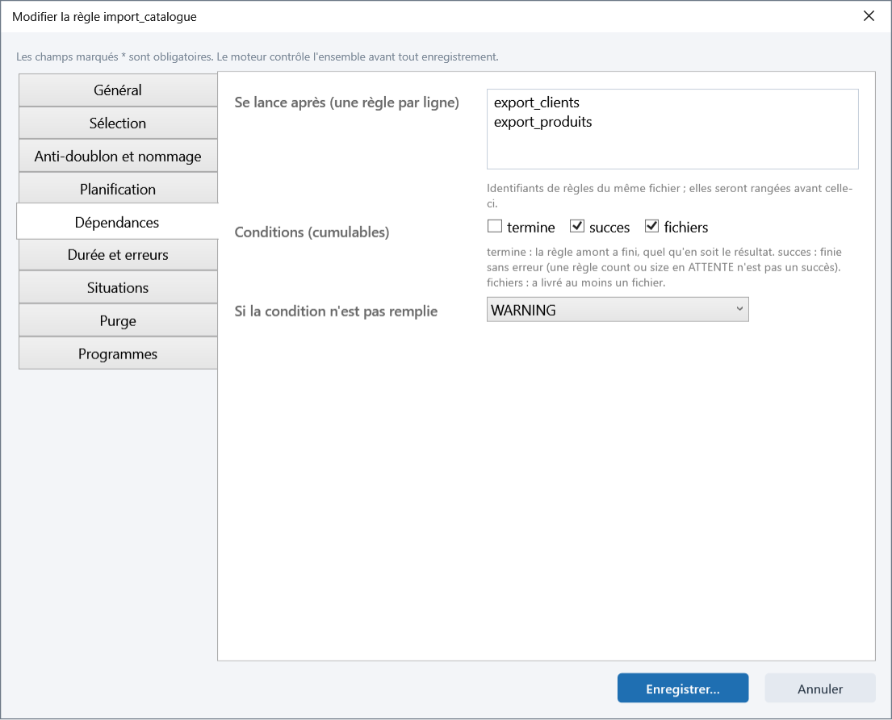

*Figure 23 : `import_catalogue` se lance après `export_clients` et `export_produits`, si elles ont réussi **et** livré au moins un fichier.*

| Champ | Sens |
|---|---|
| **Se lance après (une règle par ligne)** | Identifiants de règles **du même fichier**. Elles seront rangées avant celle-ci dans le fichier. Pas de boucle (refus D02), pas de règle inexistante (D01) |
| **Conditions (cumulables)** | `termine`, `succes`, `fichiers` (voir 4.5). Si plusieurs sont cochées, **toutes** doivent être remplies pour **chaque** règle amont |
| **Si la condition n'est pas remplie** | `INFO`, `WARNING` (défaut) ou `ERREUR` : le niveau de l'événement journalisé quand la règle ne peut pas partir, **une fois par créneau** |

La condition porte sur ce que les règles amont ont fait **depuis le dernier lancement de cette règle**. Une règle en attente **garde son créneau** : elle part dès que ses dépendances sont remplies, même si l'heure prévue est passée (dans la limite de son rattrapage). C'est ce qui fait qu'une **Reprise** de la règle en erreur relance toute la chaîne.

Contrôles utiles à connaître : une règle qui démarre **avant** celle dont elle dépend lit le résultat de la veille (avertissement D04) ; une règle plus fréquente que sa dépendance ne partira pas à chaque créneau (D05).

### 6.6 Onglet Durée et erreurs

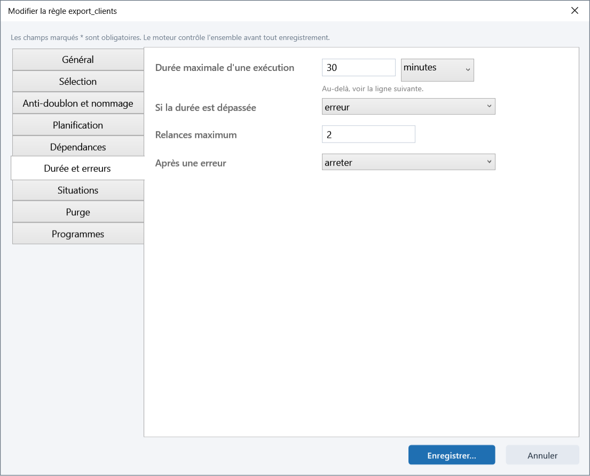

*Figure 24 : l'onglet Durée et erreurs.*

| Champ | Sens |
|---|---|
| **Durée maximale d'une exécution** | 30 minutes par défaut. Le moteur surveille chaque règle et agit au-delà (champ suivant). Prévoyez large : la durée **normale** doit rester très en dessous. L'enregistrement avertit (R09) si cette durée est inférieure à la somme des attentes prévues dans les situations |
| **Si la durée est dépassée** | `erreur` (défaut) : arrêt du programme et de tout ce qu'il a lancé, statut `ERREUR`. `relancer` : arrêt puis relance immédiate, jusqu'à *Relances maximum*. `alerter` : on laisse tourner, la règle finit en `WARNING` |
| **Relances maximum** | Relances consécutives permises si `relancer` (2 par défaut) |
| **Après une erreur** | `arreter` (défaut) : la règle ne repart qu'après une **Reprise** ou un **Acquittement**. `continuer` : elle repart à son créneau suivant. Avec `arreter`, une erreur n'est jamais « noyée » par des relances automatiques |

### 6.7 Onglet Situations

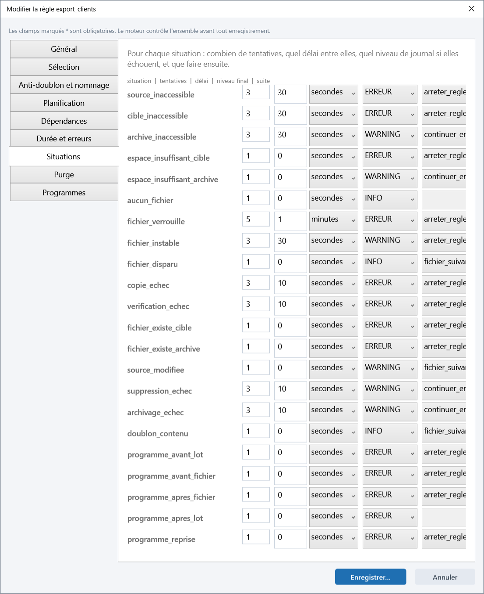

*Figure 25 : l'onglet Situations.*

Pour **chaque incident possible**, une ligne règle la réaction du moteur : combien d'**essais** (premier compris, `1` = aucun nouvel essai), quel **délai** entre deux essais (dans le même lancement), quel **niveau** de journal à l'issue du dernier essai (il décide du **statut** : `ERREUR` → `ERREUR`, `WARNING` → `WARNING`, `INFO` → n'influence pas) et quelle **suite**.

| Suite | Effet |
|---|---|
| `arreter_regle` | La règle s'arrête ; aucun fichier suivant n'est traité |
| `fichier_suivant` | Le fichier est abandonné **pour ce lancement**, les suivants sont traités. À éviter quand le destinataire exige l'ordre |
| `continuer_en_differe` | La livraison continue ; l'action qui a échoué (archivage, suppression de l'original) est mémorisée et retentée aux lancements suivants |

Les situations, avec leur valeur proposée (essais × délai, niveau, suite) :

| Situation | Quand | Proposé |
|---|---|---|
| `source_inaccessible` | partage coupé, droits manquants, dossier absent | 3 × 30 s, ERREUR, arrêt |
| `cible_inaccessible` | idem côté cible, création impossible | 3 × 30 s, ERREUR, arrêt |
| `archive_inaccessible` | dossier d'archive absent et non créable | 3 × 30 s, WARNING, continuer en différé |
| `espace_insuffisant_cible` / `_archive` | disque presque plein | 1 essai, ERREUR / WARNING |
| `aucun_fichier` | rien à livrer | 1 essai, INFO (pas de suite) |
| `fichier_verrouille` | ouvert en écriture par le fournisseur | 5 × 1 min, ERREUR, arrêt |
| `fichier_instable` | modifié pendant la copie | 3 × 30 s, WARNING, arrêt |
| `fichier_disparu` | pris par un autre logiciel entre le listage et la copie | 1 essai, INFO, fichier suivant |
| `copie_echec`, `verification_echec` | écriture impossible, taille ou empreinte différentes | 3 × 10 s, ERREUR, arrêt |
| `fichier_existe_cible` / `_archive` | si le champ « existe déjà » vaut `erreur` | 1 essai, ERREUR, arrêt |
| `source_modifiee` | nouvelle version arrivée avant la suppression ou l'archivage : l'original est conservé | 1 essai, WARNING, fichier suivant |
| `suppression_echec`, `archivage_echec` | original verrouillé (modes `deplacement`, `archivage`) | 3 × 10 s, WARNING, continuer en différé |
| `doublon_contenu` | `identite = contenu`, contenu déjà livré | 1 essai, INFO, fichier suivant |
| `programme_avant_lot`, `_avant_fichier`, `_apres_fichier`, `_apres_lot`, `_reprise` | erreur ou durée dépassée d'un programme | 1 essai, ERREUR |

Pour une règle qui ne doit **jamais** échouer en silence sur une source temporairement absente, augmentez les essais et le délai de `source_inaccessible` ; pour une règle qui peut tolérer une absence (un flux qui ne dépose pas tous les jours), mettez `aucun_fichier` en INFO (c'est le cas par défaut) et laissez la source accessible.

### 6.8 Onglet Purge

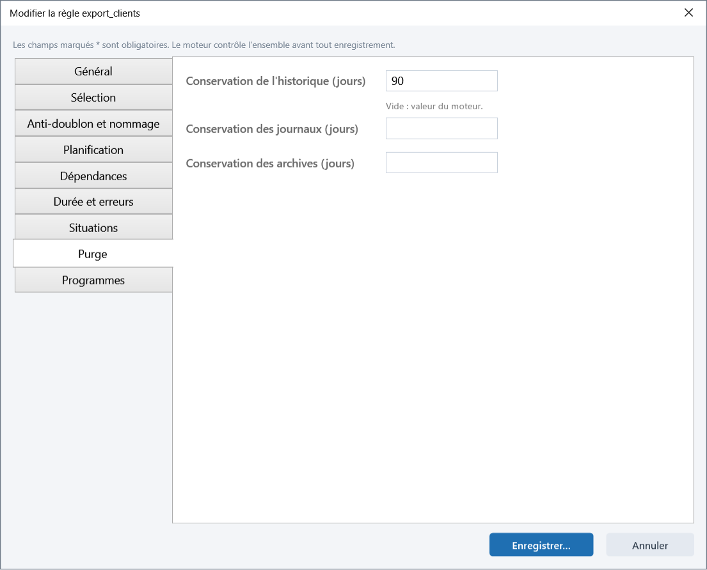

*Figure 26 : l'onglet Purge.*

| Champ | Sens |
|---|---|
| **Conservation de l'historique (jours)** | Durée pendant laquelle un fichier **non revu** reste mémorisé pour l'anti-doublon (90 par défaut). Doit être **supérieure** à la fenêtre de sélection (`Modifié depuis`, `Âge maximum`) : sinon un fichier encore dans la fenêtre serait oublié, donc relivré (refus R08) |
| **Conservation des journaux (jours)** | Durée de conservation des fichiers journaux **de cette règle**. Vide : la valeur de l'environnement ; à défaut, jamais purgés |
| **Conservation des archives (jours)** | Mode `archivage` : les dossiers d'archive **datés** plus vieux que cette durée sont supprimés avec leur contenu. Vide : l'archive n'est **jamais** purgée. Exige une archive datée (`{AAAA}` dans le chemin, sinon refus R13) |

La purge elle-même est faite par le bouton **Purger…** ([§12.6](#126-purger)) ou par le job Jenkins de purge.

### 6.9 Onglet Programmes

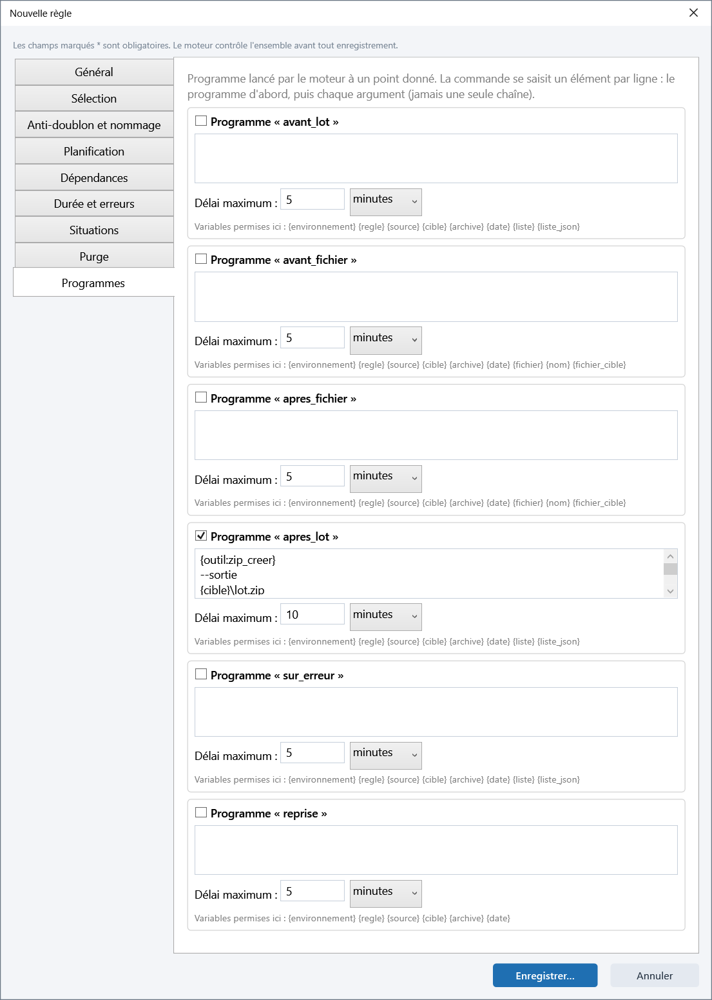

*Figure 27 : l'onglet Programmes. Ici, un programme « après lot » qui appelle l'outil `zip_creer`.*

Un **programme** est une commande que le moteur lance à un moment précis du traitement. Six points d'appel, chacun avec une case à cocher :

| Point | Quand | Usage typique |
|---|---|---|
| `avant_lot` | avant le traitement du lot (reçoit la liste des fichiers) | valider les fichiers, préparer la cible |
| `avant_fichier` | avant chaque fichier | contrôler un fichier |
| `apres_fichier` | après chaque fichier livré | notifier, indexer |
| `apres_lot` | après le lot (reçoit la liste avec le résultat de chaque fichier) | compresser, notifier la fin |
| `sur_erreur` | quand la règle s'arrête sur une anomalie | prévenir quelqu'un |
| `reprise` | au départ d'une exécution lancée par **Reprise** | nettoyer avant de repartir |

Pour chaque point : cochez la case, saisissez la **commande** (**un élément par ligne** : d'abord le programme, puis chaque argument ; jamais une seule chaîne), puis le **délai maximum** (5 minutes proposées ; au-delà, le programme est arrêté et la situation `programme_…` correspondante s'applique). Les **variables permises** sont rappelées sous chaque programme : `{environnement}`, `{regle}`, `{source}`, `{cible}`, `{archive}`, `{date}` partout ; `{fichier}`, `{nom}`, `{fichier_cible}` pour les points « fichier » ; `{liste}`, `{liste_json}` pour les points « lot » et `sur_erreur`. `{liste}` est le **chemin d'un fichier** qui contient la liste : il se passe à une option du programme (`--liste {liste}`), pas en argument isolé.

- **Un outil de la boîte à outils** s'écrit `{outil:nom}` en **premier** élément : `{outil:zip_creer}` puis `--sortie`, `{cible}\lot.zip`, `--liste`, `{liste}` (une ligne chacun). Le moteur le remplace par l'interpréteur Python et le chemin du script. La liste des outils est dans l'onglet **Outils** ([§15](#15-les-outils)).
- Le code de retour compte : **0** = succès ; **1** = « rien à faire » (sauf en `synchro`) ; autre = erreur.
- **Sécurité.** Le programme est exécuté avec le compte de service. Ajouter ou modifier un programme est **tracé** et le formulaire le rappelle. Évitez les `.bat` qui reçoivent des noms de fichiers : `cmd.exe` réinterprète certains caractères.
- En mode `synchro`, seuls `avant_lot` et `avant_fichier` sont lancés (dans cet ordre) ; `apres_fichier` et `apres_lot` ne le sont **jamais** (avertissement R18). Voir 7.6.


## 7. Obtenir tel résultat : recettes

Chaque recette donne **l'objectif**, les **champs à renseigner** (onglet : champ = valeur) et **les pièges**. Les champs non cités gardent leur valeur proposée.

### 7.1 Copier des fichiers et laisser l'original

*« Chaque nuit, envoyer au partenaire les exports du dossier `clients`, sans y toucher. »*

| Onglet | Champ | Valeur |
|---|---|---|
| Général | Mode | `copie` |
| Général | Dossier source / cible | `clients` / `clients` |
| Sélection | Masque(s) | `*.csv` |
| Sélection | Âge minimum du fichier | `2 minutes` (si le fournisseur écrit lui-même dans la source) |
| Planification | Type | `quotidien`, `02:00`, tous les jours |

Comportement : chaque fichier est livré **une seule fois**. Tant qu'il garde le même nom, la même taille et la même date, il n'est pas recopié, même s'il reste dans la source.

Pièges :

- Si le fournisseur **réécrit** un fichier existant (même nom, taille ou date différente), c'est une **nouvelle version** : elle est livrée à son tour. Avec *Si le fichier existe déjà dans la cible* = `erreur` (défaut), le moteur s'arrête sur ce fichier. Choisissez `ecraser` si le destinataire doit toujours avoir la dernière version, `suffixe` s'il doit les avoir toutes.
- Pour **voir** à l'œil quels fichiers ont déjà été pris, cochez *Horodater les fichiers traités* (§7.11).

### 7.2 Déplacer des fichiers

*« Vider la dépose du fournisseur vers notre dossier d'entrée, toutes les 10 minutes en journée. »*

| Onglet | Champ | Valeur |
|---|---|---|
| Général | Mode | `deplacement` |
| Général | Dossier source / cible | `depose` / `entree` |
| Sélection | Masque(s) | `*` (tout) ; **Âge minimum** : `1 minute` |
| Planification | Type | `intervalle`, fréquence `10 minutes`, plage `07:00`–`19:00`, du lundi au vendredi |

Comportement : la copie est **vérifiée** (taille, empreinte) avant que l'original soit supprimé. Si la suppression de l'original échoue (fichier verrouillé), la livraison est considérée comme faite et la suppression est **retentée** aux lancements suivants (situation `suppression_echec`, WARNING). Le fichier n'est donc pas livré deux fois.

Piège : `deplacement` suppose que **vous** avez le droit de supprimer dans la source. Si la source est un partage en lecture seule, utilisez `copie`.

### 7.3 Archiver : livrer puis ranger l'original

*« Livrer les factures puis les conserver 12 mois dans une archive datée. »* C'est le scénario du [§5](#5-créer-une-règle-pas-à-pas).

| Onglet | Champ | Valeur |
|---|---|---|
| Général | Mode | `archivage` |
| Général | Dossier d'archive | `.\archive\{AAAA}-{MM}-{JJ}` |
| Purge | Conservation des archives (jours) | `365` |

Comportement : chaque fichier est copié dans la cible puis **déplacé** dans l'archive. Si l'archive est inaccessible, la livraison est faite quand même et l'archivage est retenté plus tard (statut `WARNING` : *archivage dégradé*, visible dans l'onglet État).

Pièges :

- L'archive relative `.\archive` est calculée **depuis la source** ; si vous écrivez `.\archive\{AAAA}`, c'est un dossier par an.
- Pour que la **purge** supprime les vieilles archives, il faut un dossier **daté** : sans `{AAAA}` dans le chemin, l'enregistrement refuse la durée de conservation (R13).
- Le dossier d'archive est exclu du parcours de la source, même si elle est parcourue en sous-dossiers.

### 7.4 Faire le ménage : supprimer de vieux fichiers

*« Supprimer les exports de plus de 365 jours. »*

| Onglet | Champ | Valeur |
|---|---|---|
| Général | Mode | `suppression` |
| Général | Dossier source | `exports` |
| Sélection | Masque(s) | `*.csv` |
| Sélection | **Âge minimum du fichier** | `365 jours` |
| Planification | Type | `quotidien`, `03:00` |

> **Définitif.** Pas de corbeille. Sans critère d'âge ou de date, **tous** les fichiers du masque sont supprimés à chaque lancement : le champ *Âge minimum* est ce qui fait de cette règle un ménage. Faites toujours une **simulation** ([§10](#10-simuler-une-règle)) et relisez la liste avant d'activer la règle.

L'enregistrement affiche l'avertissement R15 pour vous le rappeler (voir la figure 16). Si vous voulez plutôt **garder** les vieux fichiers, `archivage` est le bon mode.

### 7.5 Attendre N fichiers, puis traiter le lot

*« Le flux dépose 5 fichiers dans la matinée ; ne les déplacer que lorsqu'ils sont tous là. »*

Deux règles :

1. **`attente_lot`** (mode `count`) : Dossier source `arrivee`, Masque `*.dat`, **Seuil minimum** `5`, planification `intervalle` toutes les 5 minutes. Quand il y a moins de 5 fichiers, elle sort en `ATTENTE` (voir la figure 6, §3.2) ; à partir de 5, en `SUCCES`.
2. **`traitement_lot`** (mode `deplacement`) : planification `apres_dependances`, Dépendances : `attente_lot`, condition `succes`.

Pièges :

- La seconde règle **ne part pas** tant que la première est en `ATTENTE` ; elle n'est pas en erreur et ne bloque rien d'autre.
- Si le flux en dépose **parfois 6**, ajoutez un *Seuil maximum* seulement si vous voulez refuser un lot trop gros (la règle reste en `ATTENTE`).
- Les deux règles doivent regarder **les mêmes fichiers** (même source, même masque).
- Si le lot a un **marqueur de fin** fiable, le *fichier déclencheur* (§7.7) est plus simple.

### 7.6 Enchaîner des règles et lancer un programme : le mode `synchro`

*« Quand `export_clients` et `export_produits` ont fini, appeler le programme d'import. »*

| Onglet | Champ | Valeur |
|---|---|---|
| Général | Mode | `synchro` (les dossiers se grisent) |
| Planification | Type | `apres_dependances` (imposé) |
| Dépendances | Se lance après | `export_clients`, `export_produits` ; conditions `succes` |
| Programmes | `avant_lot` | la commande d'import (code retour **0** = succès) |

Comportement : la règle ne touche à aucun fichier. Elle sert de **point de synchronisation** : elle ne passe en `SUCCES` que quand ses dépendances sont remplies **et** que le programme répond 0. Les règles qui viennent après dépendent d'elle.

Pièges : un code retour **1** est ici une **erreur** (dans les autres modes, « rien à faire ») ; `apres_fichier` et `apres_lot` ne sont jamais lancés (avertissement R18).

### 7.7 Attendre le signal « j'ai fini » du fournisseur : le fichier déclencheur

*« Le fournisseur dépose ses fichiers puis un fichier `fin.ok` ; ne rien prendre avant. »*

| Onglet | Champ | Valeur |
|---|---|---|
| Général | **Fichier déclencheur** | `fin.ok` (ou un masque `*.ok`) |
| Général | **Supprimer le témoin après le lot** | coché |

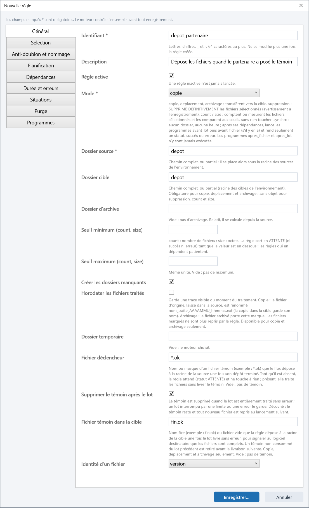

*Figure 28 : le fichier déclencheur `*.ok` et le témoin `fin.ok` déposé dans la cible (règle `depot_partenaire`, qui combine les deux, §7.8).*

Comportement : tant que `fin.ok` n'est pas **à la racine de la source**, la règle reste en `ATTENTE`, sans rien toucher. Le témoin lui-même n'est jamais livré. Quand le lot est entièrement traité sans erreur, il est supprimé : le fournisseur peut en redéposer un pour le lot suivant.

Piège : ne confondez pas les deux témoins : le **déclencheur** est déposé par le fournisseur dans la **source** (« vous pouvez y aller ») ; le **témoin dans la cible** (§7.8) est déposé par la règle (« j'ai fini, vous pouvez y aller »).

### 7.8 Prévenir le destinataire que le lot est complet : le témoin dans la cible

*« Le logiciel destinataire ne doit pas lire la cible avant que tous les fichiers soient là. »*

Champ : Général, **Fichier témoin dans la cible** = `fin.ok` (nom fixe, pas de masque).

La règle livre **d'abord** tous les fichiers, puis dépose un fichier vide `fin.ok` dans la cible, **seulement si le lot s'est bien passé**. Le destinataire le supprime quand il a fini ; s'il ne l'a pas fait, la règle le retire avant le lot suivant, puis le redépose. Si le témoin ne peut pas être écrit, la règle passe en erreur (les fichiers sont déjà livrés : déposez le témoin à la main).

### 7.9 Enchaîner plusieurs règles (chaîne de traitement)

*« Exporter les clients et les produits, puis importer le catalogue. »* C'est ce que montre le graphe de la fenêtre principale ([§11.2](#112-le-graphe-des-dépendances)).

| Règle | Planification | Dépendances |
|---|---|---|
| `export_clients` | `quotidien` 06:00 | aucune |
| `export_produits` | `quotidien` 06:00 | aucune |
| `import_catalogue` | `apres_dependances` | `export_clients`, `export_produits`, conditions `succes` + `fichiers` |

Choisissez les **conditions** selon ce que vous voulez :

- `succes` + `fichiers` : n'importer que si les exports ont **réellement livré** quelque chose (c'est le choix de la figure 23) ;
- `succes` seule : importer même s'il n'y avait rien de nouveau ;
- `termine` : importer même si un export a échoué (à éviter pour des données cohérentes).

Quand un export est en erreur, `import_catalogue` est `BLOQUEE` et le dit. Il suffit de **corriger puis reprendre** l'export : l'import partira ensuite tout seul.

### 7.10 Rattraper un gros arriéré sans saturer le réseau

*« Nous avons 40 000 fichiers en retard ; en livrer 500 à chaque passage. »* Sélection : **Nombre maximum de fichiers par lot** `500`, et/ou **Volume maximum par lot** `2 000 000 000` (octets). La règle livre un lot à chaque lancement et reprend le reste au suivant. Avec une règle `intervalle`, le retard se résorbe tout seul ; supprimez les plafonds ensuite si vous ne les voulez plus.

### 7.11 Garder une trace visible de ce qui a été traité : horodater

Général : cochez **Horodater les fichiers traités** (modes `copie` et `archivage`).

- **copie** : le fichier d'origine, resté dans la source, est renommé `rapport_traite_20261111_103012.csv`. La copie dans la cible garde son nom ;
- **archivage** : le fichier rangé dans l'archive porte cette marque.

Les fichiers marqués ne sont plus repris. Ceux qui avaient été copiés avant d'avoir coché la case sont marqués au prochain lancement. Si un fichier est verrouillé au moment du renommage, la règle sort en avertissement et réessaie au lancement suivant.

### 7.12 Garder la cible en phase avec la source : copie qui se répare

*« Si quelqu'un efface un fichier de la cible, qu'il soit recopié. »* Anti-doublon : **Si la cible est absente** = `recopier`. Par défaut (`ignorer`), un fichier déjà livré n'est pas recopié, même si la copie a disparu, car le destinataire l'a peut-être pris volontairement. Avec `recopier`, la cible est reconstituée à chaque lancement.

### 7.13 Compresser, notifier, appeler un programme : les programmes et les outils

*« Après chaque lot, zipper les fichiers livrés. »* Programmes : cochez **`apres_lot`** et saisissez, une ligne par élément :

```text
{outil:zip_creer}
--sortie
{cible}\lot_{date}.zip
--liste
{liste}
```

L'outil `zip_creer` est fourni avec le moteur ; la liste des outils et de leurs paramètres est dans l'onglet **Outils** ([§15](#15-les-outils)). Un programme peut aussi être n'importe quel exécutable du serveur (`C:\Scripts\notifier.exe`, `{outil:...}` n'est pas obligatoire).

Pièges : jamais `{liste}` seul en argument (c'est un **chemin de fichier**, à passer à une option du programme) ; chaque argument sur **sa propre ligne** ; le programme est exécuté avec le **compte de service**.

---

## 8. Enregistrer, activer, dupliquer, supprimer

### 8.1 Enregistrer

La séquence est détaillée au [§5, étape 6](#étape-6--enregistrer). Elle est identique pour **toute** modification : ajout, modification, activation, désactivation, suppression, restauration d'une version, promotion, création d'environnement. Retenez surtout :

- Le **commentaire** est obligatoire : écrivez *pourquoi* (« fréquence ramenée à 10 minutes à la demande du métier »), pas *quoi* (le moteur sait déjà ce qui a changé). C'est ce qu'on lira dans l'historique ([§13](#13-historique-restauration-et-promotion)).
- Un **refus** n'écrit rien. Vous revenez au formulaire avec votre saisie.
- Un **avertissement** n'empêche rien, mais il est conservé dans l'historique avec le compte qui l'a accepté. Exemples : une règle qui démarre avant celle dont elle dépend (D04), un mode `suppression` (R15), un masque contenant une virgule (R19), une sélection élargie qui livrerait plus de fichiers qu'avant.
- Si quelqu'un d'autre a modifié le fichier entre-temps, **rien n'est écrit** : l'interface recharge le fichier et vous refaites votre modification. Ce garde-fou évite de s'écraser mutuellement.
- L'ancienne version est **conservée** dans `versions\` avec une fiche (compte, date, commentaire) ; le fichier est remplacé en une seule opération, jamais à moitié.
- Le moteur **prend en compte** le nouveau fichier au lancement suivant (dans les 5 minutes).

### 8.2 Activer et désactiver

**Désactiver** ne change que le champ « Règle active » ; **Activer** le remet. Le commentaire est demandé et la même vérification s'applique. Désactivez une règle plutôt que de la supprimer quand vous voulez la mettre de côté provisoirement : elle reste dans le fichier et son historique est intact.

Deux contrôles à connaître : **désactiver** une règle dont d'autres dépendent est refusé tant que celles-ci sont actives (D03) ; **activer** une règle qui dépend d'une règle inactive l'est aussi.

### 8.3 Dupliquer

Pour créer une règle **voisine d'une existante** (un second flux semblable) : sélectionnez-la, **Dupliquer**, changez l'identifiant (proposé avec le suffixe `_copie`) et ce qui diffère. Les dépendances et les programmes sont repris : relisez-les. Une règle dupliquée est **active** : si elle ne doit pas partir tout de suite, décochez *Règle active*.

### 8.4 Supprimer

Retire la règle du fichier après confirmation, et demande un commentaire. **L'historique reste en base** : le moteur la signale comme « orpheline » dans le bandeau. La suppression est refusée si d'autres règles en dépendent (D01 : elles citeraient une règle inexistante). Une règle supprimée par erreur se retrouve par l'**historique** : [§13.2](#132-revenir-à-une-version-antérieure).

---

# Vérifier, tester, comprendre

## 9. Vérifier le paramétrage

### 9.1 Vérifier le paramétrage

**Vérifier le paramétrage** (disponible pour tous, au-dessus de la liste) lance, en arrière-plan, le contrôle complet du moteur : syntaxe, cohérence entre règles (dépendances, planifications, fenêtres de sélection), et accès (sources lisibles, cibles et archives accessibles en écriture, programmes présents, base utilisable, espace disque).

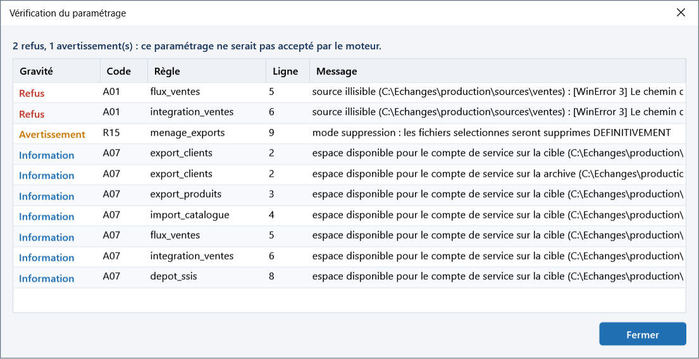

*Figure 29 : un paramétrage valide. Les refus s'affichent en rouge, les avertissements en orange, les informations en bleu ; le titre indique le total de chaque catégorie.*

Lecture d'une ligne : un **code** (R10, D04…), la **règle** concernée, le **message**. Les codes sont expliqués au [§18](#18-les-messages-de-contrôle-les-plus-fréquents). Un paramétrage avec au moins un refus **ne serait pas accepté** par le moteur : corrigez-le avant de compter sur lui.

> **Avec quel compte ?** Les accès sont contrôlés avec le compte qui exécute le moteur : avec un point d'accès JEA, celui du **compte de service** (donc de Jenkins) ; sans JEA, **le vôtre**, et dans ce cas un contrôle réussi ne prouve rien pour Jenkins. Le message en tête de fenêtre nomme le compte.

À faire **avant** de partir en congés, après chaque changement de droits ou de serveur, et chaque fois que Jenkins signale une erreur de paramétrage.

### 9.2 Contrôle des répertoires

Le moteur vérifie le fichier **sans** aller voir les dossiers (la vérification d'enregistrement est « syntaxe seule »). C'est pourquoi, **dès qu'une règle est enregistrée**, l'interface demande au moteur de contrôler ses répertoires : source, cible, dossier temporaire et archive. Pour chacun : **existe**, **lecture**, **écriture** (un petit fichier d'essai est créé puis supprimé aussitôt) ; la cible et l'archive dont le volume diffère de la source sont aussi contrôlées pour l'**espace disque**.

**Un seul écran de résultat.** Seule une *demande* (« Créer maintenant les dossiers manquants ? ») s'affiche dans une boîte Oui / Non. Tout le reste (règle enregistrée, dossiers créés, répertoires en bon état, avertissements, erreurs) est rassemblé dans **une seule fenêtre « Contrôle des répertoires »**, une ligne par information : bleu pour une information, orange pour un avertissement, rouge pour une erreur.


*Figure 30 : le contrôle des répertoires.*

- **Tout va bien** : une ligne d'information par répertoire.
- **Un problème** (dossier absent côté source, droit refusé, dossier temporaire sur un autre volume) : message en clair, avec le chemin et ce qui manque. La règle **reste enregistrée** : le contrôle n'empêche rien, il informe.
- **Un dossier absent qui peut être créé** : l'administrateur se voit proposer de le **créer**, dans **une seule question** qui les liste tous ; le contrôle est refait ensuite. **Vérifiez le chemin complet affiché avant de répondre Oui** : un dossier source absent est très souvent une faute de frappe. Au lancement, le moteur ne crée **jamais** la source seul (c'est le système producteur qui l'alimente) ; il crée la cible et l'archive si la case « Créer les dossiers manquants » est cochée.

**Avec quel compte ?** Celui qui exécute le moteur : le vôtre en mode local, celui du serveur en mode distant, le **compte de service du point d'accès JEA** si vous passez par JEA (c'est ce compte qui fera les transferts). Le message le dit.

## 10. Simuler une règle

Sélectionnez une règle, puis **Simuler la règle…** (tous les comptes) : le moteur dit ce qu'il ferait **maintenant**, **sans rien copier, déplacer ni enregistrer**. Il faut que la base de l'environnement existe et que la règle soit active. La simulation n'attend jamais : pas de temporisation entre tentatives, une source absente est signalée tout de suite. Les programmes (`avant_lot`, `apres_fichier`…) ne sont **pas** appelés.

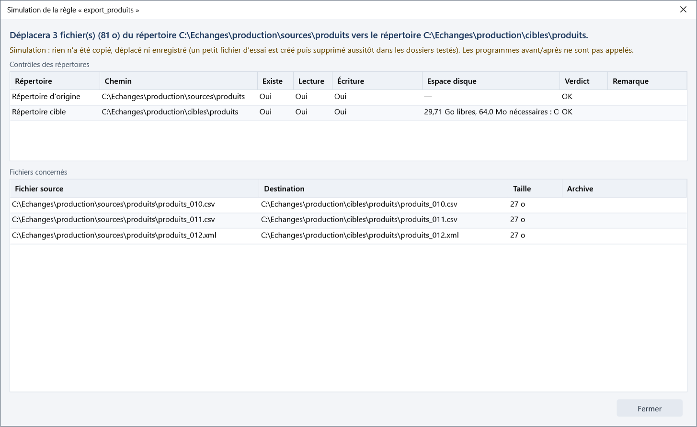

*Figure 31 : la simulation d'un déplacement de trois fichiers.*

La fenêtre montre, de haut en bas :

1. **Une phrase de synthèse** : « Déplacera 3 fichier(s) (81 o) du répertoire … vers le répertoire … ». Selon le mode : *Copiera… Les originaux restent en place* ; *… puis archivés dans…* ; *Supprimera définitivement…* ; *Comptera…*.
2. **La note** : rien n'a été modifié (hors un petit fichier d'essai, créé puis supprimé aussitôt dans les dossiers testés).
3. **Contrôles des répertoires**, un par ligne :

   | Colonne | Sens |
   |---|---|
   | Répertoire | Origine, cible, temporaire, archive |
   | Existe | Oui / Non |
   | Lecture / Écriture | Droits du compte du moteur ; « création possible » pour un dossier absent qu'on pourrait créer |
   | Espace disque | Libre et nécessaire (fichiers listés plus la marge de l'environnement), OK ou INSUFFISANT |
   | Verdict | `OK`, `A_CREER` (absent mais créable), `PROBLEME` |
   | Remarque | Ce qui coince |

4. **Fichiers concernés** : source, destination, taille, archive, plafonnée à 500 lignes (le total de la phrase de synthèse reste exact).
5. **Remarques** : fichiers ignorés (déjà livrés, doublons), avertissements, nombre de problèmes.

Pour un administrateur, si des dossiers manquent, un bouton **Créer les dossiers manquants…** apparaît : confirmation, création (source, cible, temporaire, archive), puis la simulation est refaite.

**Quand simuler ?** Après avoir créé ou modifié une règle ; **toujours** avant d'activer une règle `suppression` ; quand une règle « ne trouve pas ses fichiers » (la simulation montre ce que le masque et les âges retiennent *maintenant*) ; quand on change de serveur ou de droits.

Une règle qui n'a **rien à faire** donne « Aucun fichier à traiter » : vérifiez alors le dossier source, le masque, l'**âge minimum** (un fichier trop récent est ignoré) et la fenêtre *Modifié depuis*.

## 11. Lire l'état, le graphe des dépendances et les journaux

### 11.1 Actualiser et comprendre un état

**Actualiser l'état** relit le fichier et le statut des règles et **conserve la règle sélectionnée**. Rien n'est interrogé automatiquement : si vous attendez une règle, cliquez de temps en temps.

Si le bandeau (en haut de l'onglet) indique **« État indisponible : … »**, la liste des règles s'affiche quand même, d'après le fichier, mais **sans statut** : la base n'est pas initialisée, le moteur est injoignable ou trop ancien. Le message donne la raison (voir §17).

### 11.2 Le graphe des dépendances


*Figure 32 : l'onglet Dépendances (rappel du §3.3).*

L'onglet **Dépendances** dessine les règles qui dépendent les unes des autres : chaque règle est **à droite** de celles qu'elle attend, la flèche va de la règle attendue vers celle qui attend. Les règles sans lien ne sont pas dessinées (leur nombre est indiqué).

- La **couleur** est celle du statut ; un nœud estompé est une règle inactive ; l'infobulle donne le motif d'attente.
- Une flèche **rouge** désigne la règle qui retient les autres (règle `EN_ATTENTE` ou `BLOQUEE` dont le motif la nomme).
- Un **clic** sur un nœud sélectionne la règle dans la liste (si un filtre la masque, rien ne se passe : assouplissez les filtres).

### 11.3 Les journaux d'une règle

**Journaux…** (à côté de « Simuler la règle… » et « Historique… ») ouvre les journaux de la règle sélectionnée, qu'elle soit en erreur ou non : plus besoin d'ouvrir un fichier JSON.

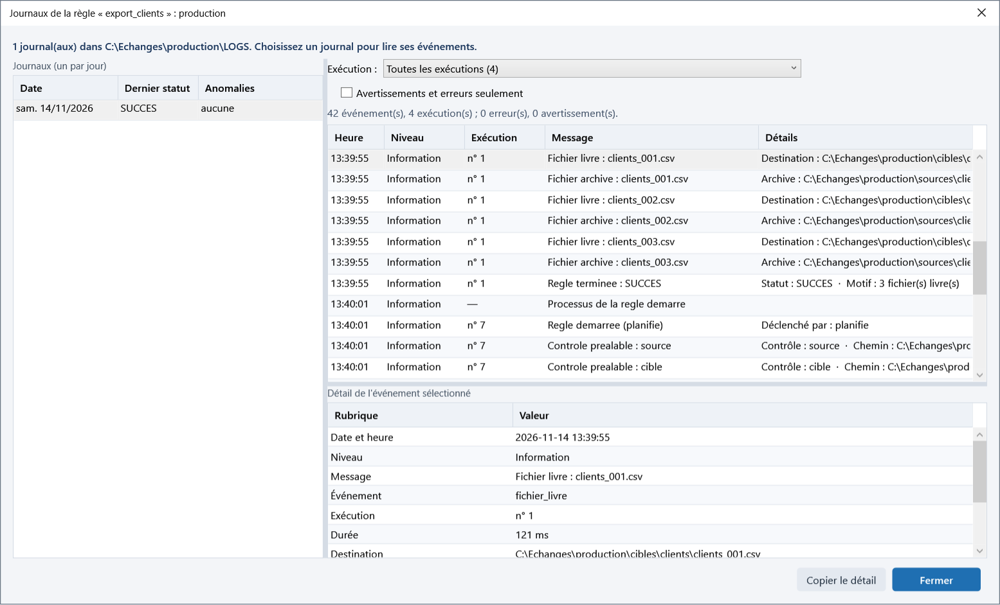

*Figure 33 : les journaux de `export_clients` : un journal par jour à gauche, le contenu à droite, le détail en bas.*

- **À gauche**, un journal **par jour**, le plus récent en premier : date, dernier statut, anomalies (nombre d'erreurs et d'avertissements, ligne rouge ou orange s'il y en a).
- **À droite, en haut** : la liste déroulante **Exécution** (la plus récente est choisie d'office ; « Toutes les exécutions » pour tout voir) et la case **Avertissements et erreurs seulement** pour ne garder que ce qui demande de l'attention.
- **Au milieu** : les événements, une ligne chacun (heure, niveau, numéro d'exécution, message, détails).
- **En bas** : le **détail** de l'événement sélectionné, écrit en clair (date, niveau, message, type d'événement, durée, fichier, destination, taille, compteurs, type d'erreur…). **Copier le détail** le met dans le presse-papiers, pour un message ou un ticket.

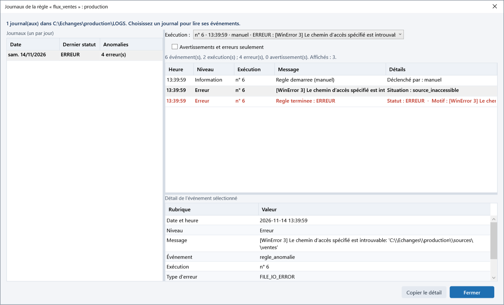

*Figure 34 : `flux_ventes` en erreur : la source est introuvable (WinError 3, situation `source_inaccessible`). Cochez « Avertissements et erreurs seulement » pour aller droit à la cause ; le détail de la ligne sélectionnée donne le type d'erreur.*

Les lignes « Simulation n » viennent de **Simuler la règle…**. Seuls les 1 500 derniers événements d'un journal très long sont lus ; le fichier complet reste dans le dossier des journaux de l'environnement.

**Méthode de diagnostic** : 1) onglet État : le motif ; 2) Journaux, case « Avertissements et erreurs seulement » : l'événement fautif et son type d'erreur ; 3) corriger la cause ; 4) **Reprise** ([§12.1](#121-reprise)).

---

# Exploitation

## 12. Agir sur une règle

Toutes ces actions sont réservées aux **administrateurs** et tracées avec **votre compte** dans la base, le journal du moteur et celui de l'interface. Quand le moteur refuse (règle déjà en cours, commentaire manquant…), son message est affiché tel quel et rien n'est modifié. Les boutons sont grisés tant qu'un appel du moteur est en cours.

| Je veux… | Bouton | Effet |
|---|---|---|
| relancer après avoir **corrigé** la cause | Reprise | Part au prochain lancement ; programme « reprise » d'abord |
| lancer **sans attendre** l'heure | Lancer maintenant | Part au prochain lancement, sans programme de reprise |
| déclarer une erreur **traitée à la main** | Acquitter | `ERREUR` → `ACQUITTEE`, sans relance |
| arrêter une exécution **figée** | Débloquer | Tue le processus et ses descendants |
| dire si un fichier est arrivé ou non | Trancher… | Résout une livraison incertaine |
| supprimer les vieux journaux et archives | Purger… | Après aperçu et confirmation |

### 12.1 Reprise

À utiliser après avoir **corrigé la cause** d'une erreur : la règle repartira **au prochain lancement**, quelle que soit l'heure, et son programme « reprise » sera appelé en premier s'il existe. La confirmation liste les règles qui **dépendent** de celle-ci : elles repartiront d'elles-mêmes dès que leurs dépendances seront remplies. Le commentaire est facultatif mais recommandé.

Si la règle est réglée sur `apres_erreur = arreter` (défaut), la reprise est **la seule façon** de la relancer.

### 12.2 Lancer maintenant

La règle part au prochain lancement sans attendre son créneau et **sans** programme de reprise. Utile pour une règle nouvelle ou pour une relance ponctuelle.

### 12.3 Acquitter

Pour une règle en `ERREUR` que vous considérez comme **traitée à la main** (le fichier a été livré autrement, l'erreur est sans conséquence) : elle passe en `ACQUITTEE` sans être relancée. Le **commentaire est obligatoire** : écrivez ce que vous avez fait. Pour que la règle reparte, utilisez plutôt **Reprise**.

### 12.4 Débloquer

Une règle `EN_COURS` qui ne se termine pas (programme figé) : **Débloquer arrête l'exécution**, tue le processus et tous ses descendants, et libère la règle (elle passe en erreur). Selon son réglage `apres_erreur`, une **reprise** est ensuite nécessaire ; l'interface le signale.

> À n'utiliser que si l'exécution est **réellement figée** : une copie interrompue en pleine écriture devient une **livraison incertaine** (§12.5). Avant de débloquer, regardez la durée maximale de la règle : le moteur l'arrêtera de toute façon.

### 12.5 Trancher une livraison incertaine

Quand une exécution est arrêtée brutalement **pendant la copie d'un fichier** (coupure, déblocage), le moteur ne sait pas si le fichier est arrivé entier. Pour ne **jamais créer de doublon**, il s'arrête et la règle reste en erreur (« livraison incertaine ») ; l'onglet **État** affiche leur nombre. Le bouton **Trancher…** est actif quand la règle sélectionnée en a.

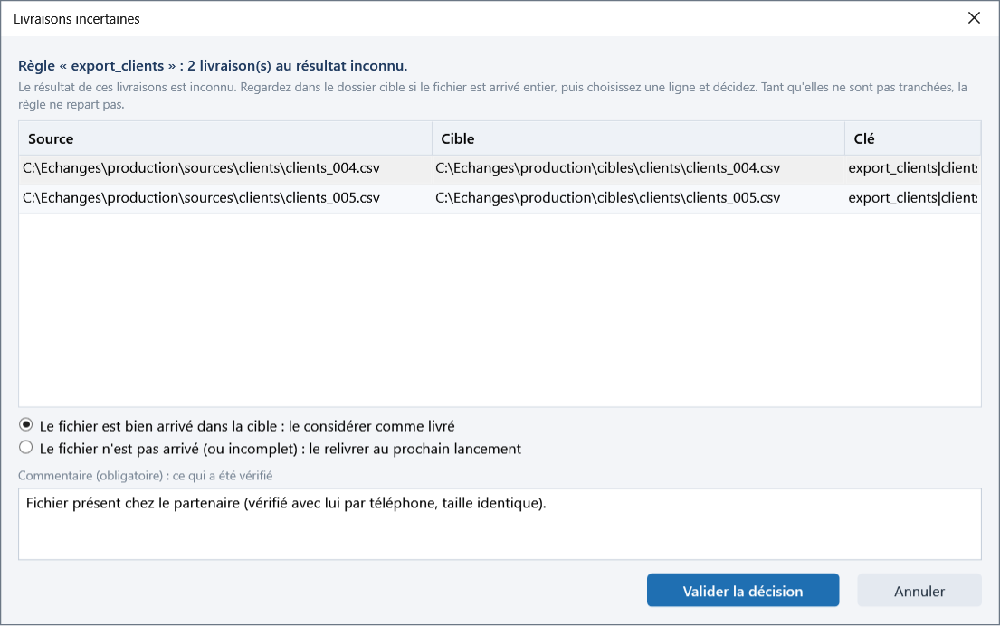

*Figure 35 : deux livraisons incertaines pour `export_clients`.*

1. **Regardez dans le dossier cible** : le fichier est-il là, **entier** ? (Au besoin, comparez la taille avec la source, ou demandez au destinataire.)
2. **Trancher…** ouvre la liste (source, cible, clé). Choisissez une ligne.
3. Choisissez **« Le fichier est bien arrivé dans la cible : le considérer comme livré »** ou **« Le fichier n'est pas arrivé (ou incomplet) : le relivrer au prochain lancement »**.
4. Saisissez un **commentaire obligatoire** (ce que vous avez vérifié), puis **Valider la décision**.

Une livraison est tranchée à la fois : recommencez pour les suivantes (l'interface indique combien il en reste). Une fois toutes tranchées, demandez une **Reprise** pour que la règle reparte.

### 12.6 Purger

**Purger…** supprime les **journaux** et les **archives datées** plus anciens que la durée de conservation réglée dans le paramétrage (onglet Purge d'une règle, ou en-tête de l'environnement). Si une règle est sélectionnée, l'interface demande si la purge ne doit porter que sur elle.

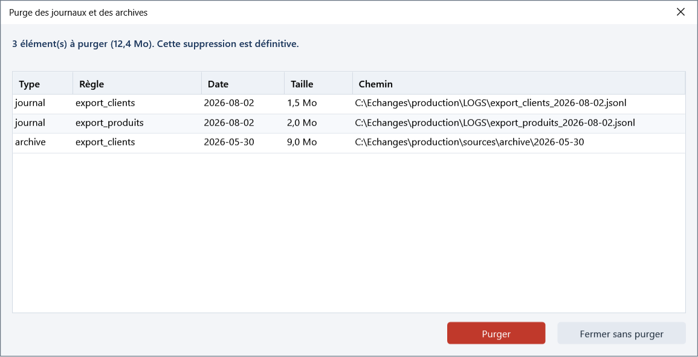

*Figure 36 : l'aperçu de la purge. Rien n'est supprimé à ce stade.*

1. L'interface affiche d'abord la **liste** de ce qui serait supprimé (type, règle, date, taille, chemin), les règles non purgeables et les éléments ignorés.
2. **Purger** confirme ; **Fermer sans purger** abandonne. La suppression est **définitive**.

Le job Jenkins de purge fait la même chose chaque jour ; commencez par lire la liste avant d'activer l'option `--appliquer`.

## 13. Historique, restauration et promotion

### 13.1 Lire l'historique

**Historique…** liste les modifications faites par l'interface, **de la plus récente à la plus ancienne** : date, compte, commentaire. Sélectionnez une ligne : la partie droite affiche **ce que cette modification a changé** (règle ajoutée, supprimée, modifiée champ par champ, en-tête), les **avertissements acceptés** à l'époque, et signale une version sans fiche (copiée à la main : compte et date sont alors lus dans le nom du fichier).

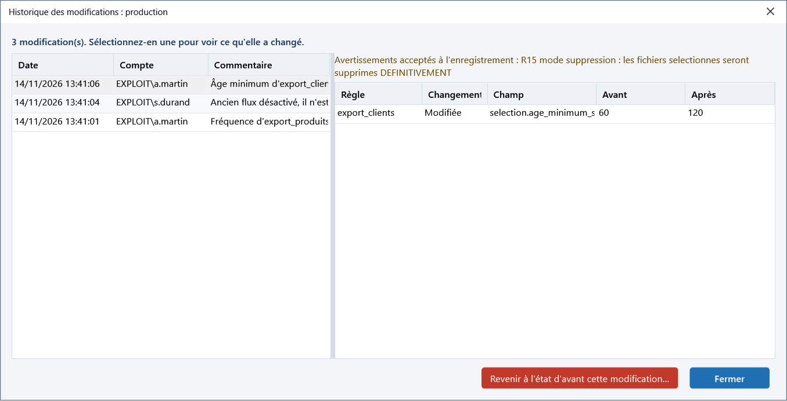

*Figure 37 : l'historique. La modification sélectionnée a porté l'âge minimum d'`export_clients` de 60 à 120 secondes ; l'avertissement R15 avait été accepté.*

Bouton visible pour tous quand le dossier des versions est lisible avec votre compte.

### 13.2 Revenir à une version antérieure

(Administrateurs.) Choisissez la modification à **défaire**, puis **Revenir à l'état d'avant cette modification…**. L'interface indique le nombre de différences avec le fichier actuel : **les modifications faites depuis seront annulées**. Après confirmation, le commentaire est demandé et l'enregistrement suit le [§8.1](#81-enregistrer) (le moteur peut avertir qu'une règle disparaît : c'est normal).

**Rien n'est effacé** : l'état avant restauration est lui-même conservé, la restauration est une ligne de l'historique et peut être défaite de la même façon. C'est aussi le moyen de **retrouver une règle supprimée**.

### 13.3 Promouvoir une règle vers un autre environnement

Pour reprendre une règle validée (par exemple de la recette vers la production) en **adaptant ses chemins** : sélectionnez-la, puis **Promouvoir…** (administrateurs ; il faut pouvoir modifier l'environnement cible).

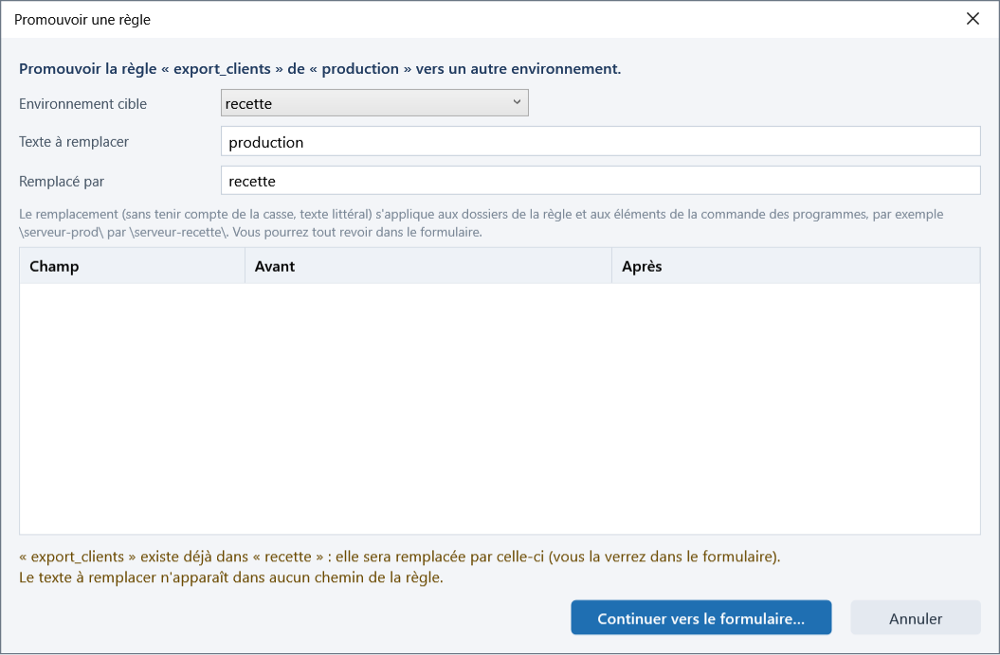

*Figure 38 : promotion de `export_clients` de `production` vers `recette`.*

1. Choisissez l'**environnement cible**.
2. Saisissez le **texte à remplacer** et le **texte de remplacement** (par exemple `\\serveur-prod\` par `\\serveur-recette\`). Le remplacement est littéral, sans tenir compte de la casse, et s'applique aux dossiers de la règle et à la commande de ses programmes. Le tableau montre, champ par champ, l'**avant** et l'**après**.
3. L'interface signale en orange si la règle **existe déjà** dans la cible (elle sera remplacée, et vous le verrez dans le formulaire), si les règles dont elle dépend **n'y existent pas**, ou si le **texte à remplacer n'apparaît nulle part**.
4. **Continuer vers le formulaire…** : la règle adaptée s'ouvre dans le formulaire de la cible. Vous relisez, puis l'enregistrement suit **exactement** le [§8.1](#81-enregistrer) : la promotion ne contourne aucun contrôle.

Dans l'exemple de la figure, les chemins de la règle sont **partiels** (`clients`) : ils suivent d'eux-mêmes la racine de l'environnement cible, donc **aucun remplacement n'est nécessaire** (l'avertissement « n'apparaît dans aucun chemin » l'indique). Des chemins partiels sont la bonne pratique ([§4.3](#43-où-les-met-on---cible-archive-nommage)) : promouvoir devient presque gratuit.

Après la promotion, pensez à **désactiver** la règle dans l'environnement cible si elle ne doit pas partir tout de suite, et à la **simuler** ([§10](#10-simuler-une-règle)) avec les droits de cet environnement.


---

# Environnements et outils

## 14. Gérer les environnements (administrateurs)

Un **environnement** est un fichier de paramétrage et sa propre base (par exemple `production`, `recette`, `preprod`). Au-dessus des onglets, la barre **Environnements** n'est visible que pour un administrateur ; elle agit sur l'**onglet sélectionné** (sauf **Nouvel environnement…**, toujours actif). Sur l'onglet **Outils**, les boutons qui visent un environnement sont grisés (voir la figure 43).

Toutes ces opérations passent par un **brouillon vérifié par le moteur** avant l'écriture et sont **tracées** (journal de l'interface : compte, action, résultat). Le contrôle des droits de l'interface ne remplace pas ceux du dossier de paramétrage (NTFS) : voir [10-installation](10-installation.md).

**Une seule fenêtre de résultat.** Chaque opération pose ses **questions** en boîtes Oui / Non (accord pour créer les dossiers, changement de base, suppression), puis rassemble **tout le reste** (enregistrement, dossiers créés, base créée ou non, avertissements, erreurs) dans **une seule fenêtre** à la fin, une ligne par information.

| Bouton | Ce qu'il fait |
|---|---|
| **Nouvel environnement…** | Crée le fichier (sans règle) et sa base. Proposé d'office quand le dossier de paramétrage est vide |
| **Modifier / renommer…** | Modifie l'en-tête ; permet de renommer |
| **Copier vers un nouvel environnement…** | Nouvel environnement avec **toutes les règles** de l'original |
| **Créer la base…** | Crée la base d'un environnement qui n'en a pas encore ; refuse d'écraser une base existante |
| **Supprimer…** | Range l'environnement (réversible), après double validation |

### 14.1 Créer un environnement

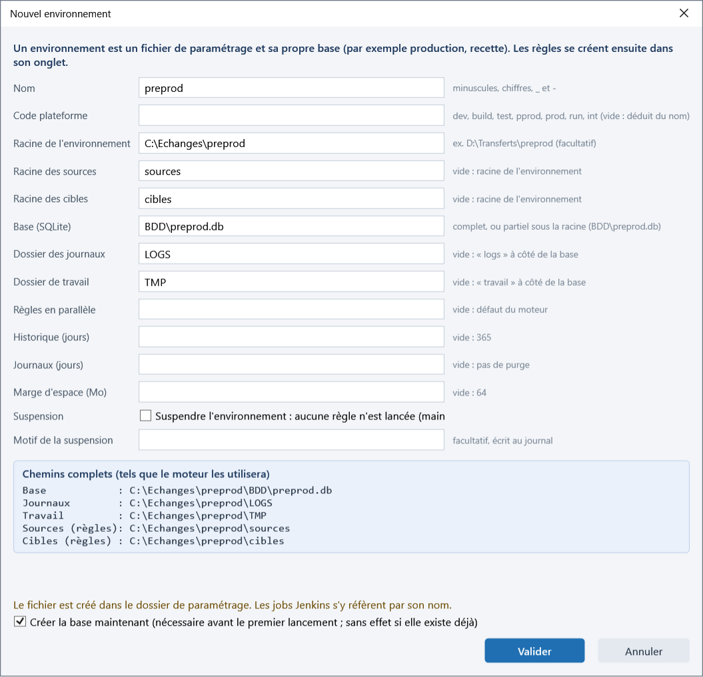

*Figure 39 : un nouvel environnement `preprod`, avec sa racine et ses chemins partiels.*

| Champ | Sens et conseils |
|---|---|
| **Nom** | Minuscules, chiffres, `_` et `-`, 32 caractères au plus. Il devient le nom du fichier (`preprod.jsonl`) et celui de l'environnement dans la base. Refusé s'il est déjà utilisé |
| **Code plateforme** | Pour la plateforme d'observabilité : `dev`, `build`, `test`, `pprod`, `prod`, `run`, `int`. Vide : déduit du nom |
| **Racine de l'environnement** | Facultative. Dossier de base de l'environnement : tous les chemins **partiels** s'y placent. Exemple : `D:\Transferts\preprod` |
| **Racine des sources / des cibles** | Complète les dossiers source / cible **partiels** des règles. Vides : la racine de l'environnement sert aux deux. Exemple : `sources` et `cibles` donnent `…\preprod\sources\clients` |
| **Base (SQLite)** | Fichier de la base. **Local** (pas de partage réseau). Partiel sous la racine (`BDD\preprod.db`) ou complet. Refusé s'il est déjà utilisé par un autre environnement |
| **Dossier des journaux** | Où le moteur écrit ses journaux. Vide : `logs` à côté de la base |
| **Dossier de travail** | Fichiers temporaires du moteur. Vide : `travail` à côté de la base |
| **Règles en parallèle** | Nombre de règles exécutées en même temps. Vide : défaut du moteur |
| **Historique (jours)** | Durée de conservation de l'historique d'exécution en base. Vide : 365 |
| **Journaux (jours)** | Durée de conservation des fichiers journaux, pour toutes les règles qui n'ont pas la leur. Vide : jamais purgés |
| **Marge d'espace (Mo)** | Espace à laisser libre en plus des fichiers à copier (contrôle d'espace disque). Vide : 64 |
| **Suspension** | Voir §14.5 |
| **Motif de la suspension** | Facultatif, écrit au journal |

L'encadré **Chemins complets** montre, en direct, ce que le moteur utilisera. **Contrôlez-le avant de valider** : c'est là qu'on voit une racine mal saisie.

En bas :

- *« Créer la base maintenant »* (cochée par défaut) : sans base, aucune règle ne peut tourner (« État indisponible ») ;
- **Valider** crée le fichier **sans règle**, puis contrôle les dossiers.

**Racines.** Un chemin *partiel* est placé sous la racine, un chemin *complet* (`D:\LOGS`, `\\serveur\partage`) est conservé ; le `\` final de la racine est facultatif. Avec la racine `D:\Transferts\preprod`, la base `BDD\preprod.db` devient `D:\Transferts\preprod\BDD\preprod.db`.

**Les dossiers de la base, des journaux et du travail.** Dès que le fichier d'un environnement est écrit (création, copie, modification de ces chemins, bouton « Créer la base… »), l'interface contrôle les trois dossiers **là où tourne le moteur**. S'il en manque, **une seule question** les liste et propose de les créer (Oui / Non), en rappelant le compte dont les droits sont contrôlés. Oui : ils sont créés (tracé dans le journal de l'interface), puis la base. Non : le fichier reste créé, la base ne l'est pas, et le message le dit. Un dossier qu'on ne peut pas créer (lecteur introuvable, droits) est signalé en clair. Cette règle vaut pour **tout chemin saisi dans l'outil** : dossier de paramétrage, dossiers d'un environnement, répertoires d'une règle ([§9.2](#92-contrôle-des-répertoires)) et simulation ([§10](#10-simuler-une-règle)).

Après la création : l'environnement apparaît dans un nouvel onglet, vide. **Il faut encore** créer un **job Jenkins** qui lance le moteur sur ce fichier (voir [10-installation](10-installation.md)) : sans job, rien ne s'exécute, et l'interface ne le fait pas pour vous.

### 14.2 Modifier ou renommer

**Modifier / renommer…** rouvre la même fenêtre pour l'en-tête de l'environnement sélectionné.

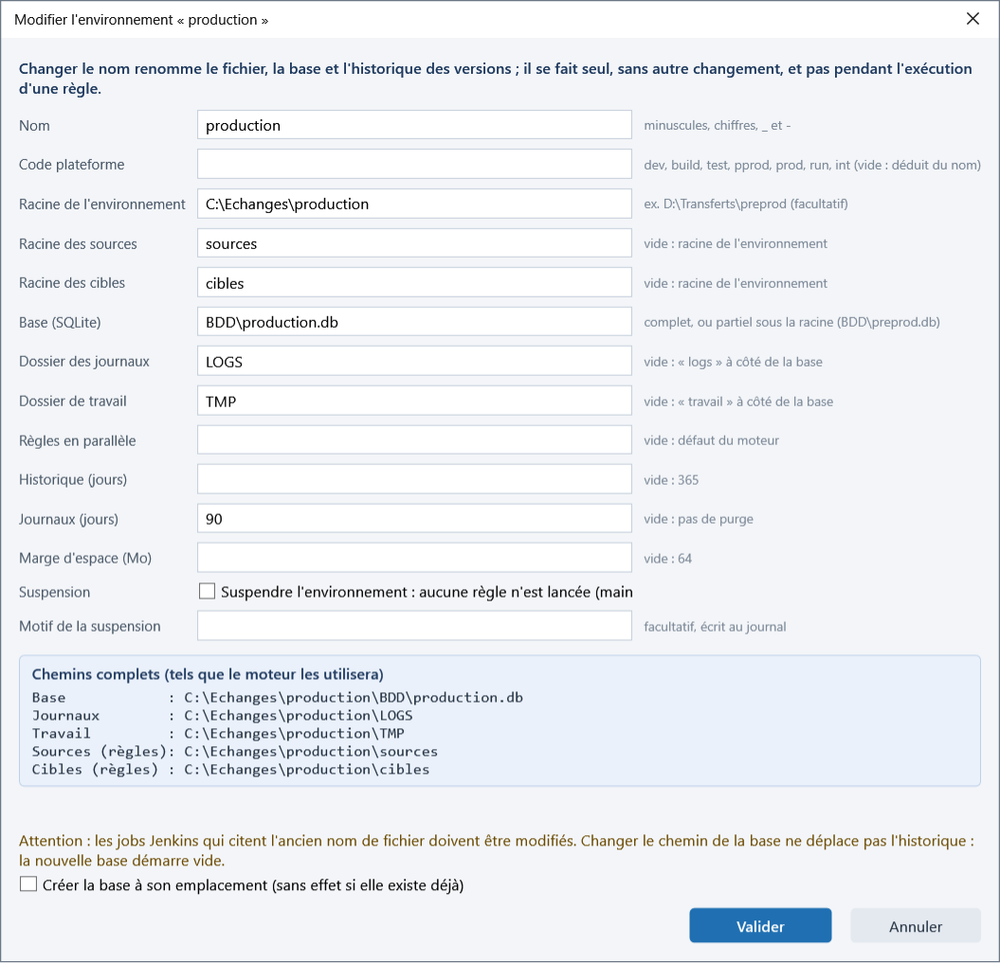

*Figure 40 : modification de `production`. En bas, deux avertissements : les jobs Jenkins citent le nom du fichier, et changer de base ne déplace pas l'historique. La case « Créer la base à son emplacement » est décochée par défaut.*

- Changer des **racines**, des **rétentions** ou le **parallélisme** est un changement d'en-tête simple.
- **Changer le chemin de la base ne déplace pas l'historique** : la nouvelle base démarre **vide** (confirmation demandée). Pour déplacer une base, faites-le à la main, moteur arrêté.
- **Renommer** change le nom du fichier, de l'environnement dans la base et de l'historique des versions. Il se fait **seul**, sans autre changement, et est refusé tant qu'une règle s'exécute. Les **jobs Jenkins** qui citent l'ancien nom de fichier restent à modifier.

### 14.3 Copier vers un nouvel environnement

Usage typique : créer la **préproduction** à partir de la **production**.

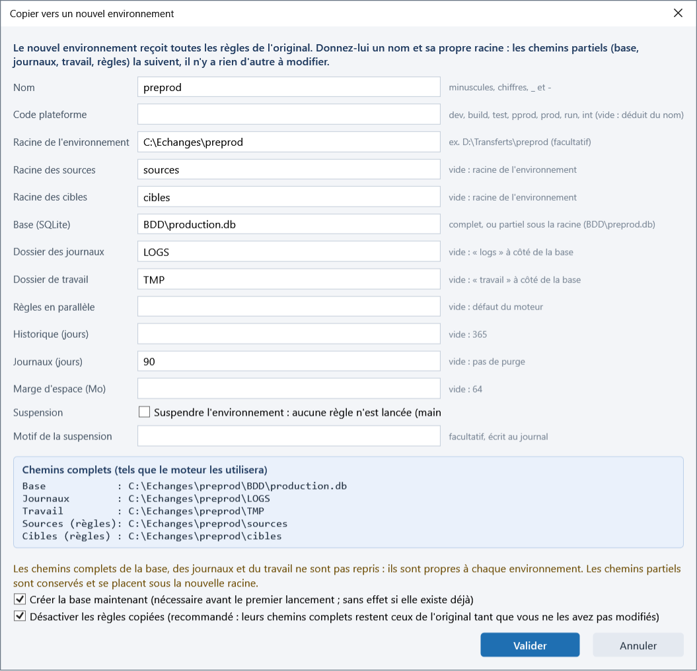

*Figure 41 : copie de `production` vers `preprod`. Le nom de la base n'est pas modifié automatiquement : corrigez-le (ici `BDD\production.db` devrait devenir `BDD\preprod.db`).*

- Les **règles gardent leurs répertoires** : s'ils sont **partiels**, ils suivent la nouvelle racine sans rien modifier ; s'ils sont **complets**, c'est à vous de les corriger ensuite.
- Le nom, la base et les dossiers des journaux et du travail propres à chaque environnement sont **à saisir**.
- Par défaut les règles sont copiées **désactivées** (case *Désactiver les règles copiées*), pour que deux environnements ne livrent pas **les mêmes fichiers au même endroit** pendant que vous adaptez les chemins. Décochez-la seulement si les chemins sont déjà tous partiels et corrects.
- Réactivez ensuite les règles une à une (§8.2) après les avoir **simulées** (§10).

### 14.4 Créer la base

**Créer la base…** crée la base d'un environnement existant qui n'en a pas (fichier créé avec « Créer la base » décoché, ou dossier de base supprimé). Refuse d'écraser une base existante. Même contrôle des dossiers (une seule question) qu'à la création.

### 14.5 Suspendre un environnement

Dans la fenêtre de modification, cochez **Suspendre l'environnement** : tant que la case est cochée, **aucune règle n'est lancée** et Jenkins reste vert (code 0). Un **bandeau** le rappelle sur l'onglet. Utile pour une maintenance (serveur de fichiers, migration). Renseignez le **motif** : il est écrit au journal.

Pensez à décocher : la plateforme d'observabilité peut vous alerter d'une suspension qui dure (`exemples\loki\regles_alerte.yaml`).
### 14.6 Supprimer un environnement

**Double validation** : 1) un avertissement qui détaille les conséquences ; 2) la saisie du **nom exact** de l'environnement et d'un commentaire.

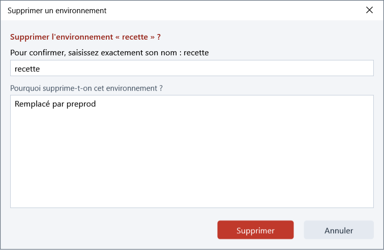

*Figure 42 : la seconde validation. Le bouton rouge ne fait que ranger l'environnement.*

**Rien n'est effacé** : le fichier et ses versions sont rangés dans `.supprimes\<nom>_<date>\` avec une fiche (compte, date, commentaire, chemin de la base). Pour annuler, remettre le fichier `.jsonl` dans le dossier de paramétrage. La **base, les journaux et les archives ne sont jamais touchés**. Refusé tant qu'une règle s'exécute. Les jobs Jenkins qui citent cet environnement sont à supprimer ou à modifier à la main.

## 15. Les outils

Les **outils** sont de petits scripts (compresser, chercher, renommer, valider, envoyer un courriel, transférer par SFTP…) que les règles peuvent appeler comme programmes (`avant_lot`, `apres_fichier`…). L'onglet **Outils**, le dernier de la fenêtre, les liste : il concerne le **moteur**, pas un environnement.

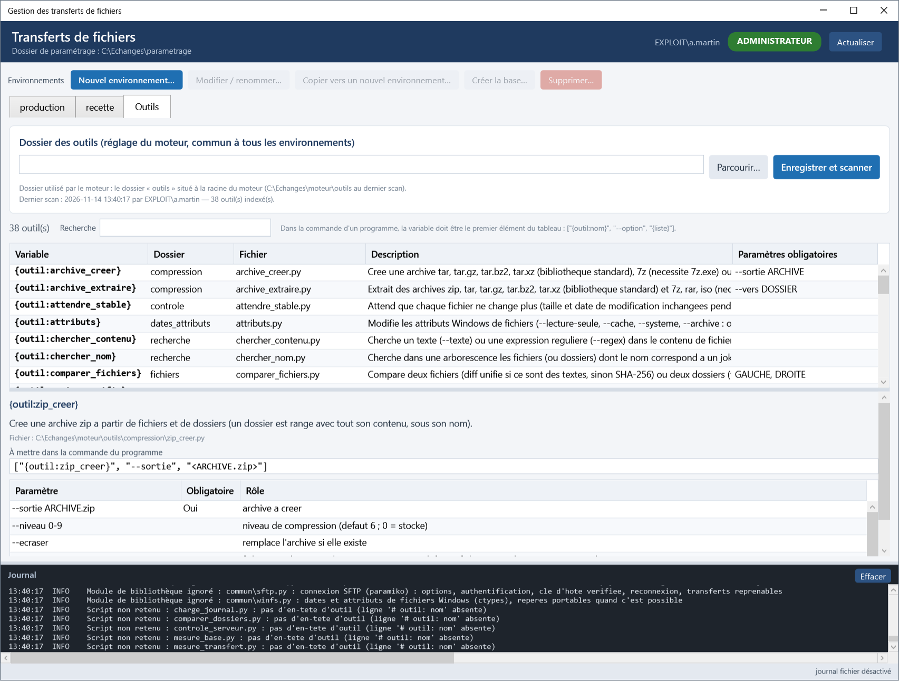

*Figure 43 : l'onglet Outils après un scan : 38 outils indexés, `{outil:zip_creer}` sélectionné.*

- **Dossier des outils** : laissez vide pour utiliser le dossier `outils` livré avec le moteur (la ligne grise dessous dit lequel, et la date du dernier scan), ou indiquez un autre dossier (**Parcourir…**). Le réglage est **commun à tous les environnements**.
- **Enregistrer et scanner** (administrateurs) : l'application parcourt le dossier et ses sous-dossiers, retient chaque script qui a un **en-tête d'outil** (commentaires `# outil:`, `# description:`, `# parametre:` en haut du fichier) et **enregistre la liste**.
- **La liste** donne la **variable** de chaque outil (`{outil:zip_creer}`), son dossier, son fichier, sa description et ses paramètres obligatoires ; **Recherche** filtre.
- En **choisissant un outil**, vous voyez tous ses paramètres (obligatoire ou non, rôle) et un **début de commande** à recopier dans l'onglet *Programmes* d'une règle. La variable doit être le **premier élément** de la commande.

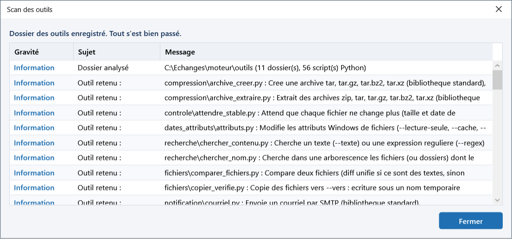

*Figure 44 : le résultat d'un scan : dossier analysé, outils retenus, et (plus bas) les scripts non retenus avec la cause.*

Une fenêtre résume chaque scan : les **outils retenus** et les scripts **non retenus avec la cause** : « pas d'en-tête » (script ordinaire ou module de bibliothèque : sans gravité), en-tête invalide, nom déjà pris, fichier illisible. **Rien n'est enregistré si aucun outil n'est trouvé** : un mauvais dossier ne remplace pas la bonne liste.

**À refaire** après avoir ajouté, retiré ou déplacé un outil. Si une règle utilise un outil que la liste ne connaît pas, le contrôle du paramétrage la refuse (G01) en citant les outils connus : scannez, ou corrigez le nom.

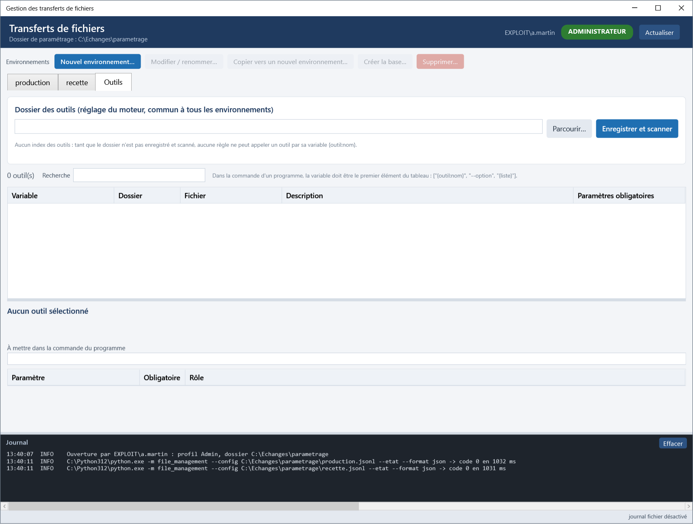

*Figure 45 : avant le premier scan, la liste est vide : cliquez sur « Enregistrer et scanner ».*

Écrire un nouvel outil : [13-boite-a-outils §7](13-boite-a-outils.md).

## 16. Le journal de l'interface

Le panneau du bas de la fenêtre montre ce que fait l'interface : ouverture, appels du moteur avec leur **code retour** et leur **durée**, enregistrements, actions. **Effacer** le vide à l'écran (pas dans le fichier).

Si `Journal.Dossier` est renseigné dans le fichier de configuration de l'interface (`Gestion-Copie.config.psd1`), le même journal est écrit chaque jour dans un fichier JSON Lines lu par la plateforme de surveillance (service `file_management.interface`, `context.utilisateur` = le compte ; une session = une trace). C'est **la trace de qui a fait quoi** côté interface : la base et le journal du moteur gardent leur propre trace. La barre d'état, tout en bas, indique si le journal fichier est actif (« journal fichier désactivé » sinon).

Quand vous contactez l'exploitation à propos d'un problème, **copiez les dernières lignes de ce panneau** : on y lit la commande envoyée au moteur, son code retour et le message d'erreur exact.

---

# Aide

## 17. Que faire quand…

### Une règle ne fait pas ce qu'on attend

| Situation | Cause probable | Action |
|---|---|---|
| Une règle est `ERREUR` | Voir l'onglet État | Lire le motif ; Journaux… ; corriger la cause (droits, dossier, programme) ; **Reprise** ; ou **Acquitter** si traité à la main |
| Des règles sont `BLOQUEE` | Une règle dont elles dépendent est en `ERREUR` | Regarder le graphe : la flèche rouge désigne la règle en erreur ; la corriger et la reprendre, toute la chaîne repart |
| Une règle est `EN_ATTENTE` | Ses dépendances n'ont pas fini | Rien : elle partira. Si ça dure, regarder la règle amont |
| Une règle est `ATTENTE` | Seuil `count`/`size` non atteint, ou témoin absent | Vérifier le dossier source (nombre de fichiers, présence du témoin) |
| Une règle est `EN_COURS` depuis trop longtemps | Programme figé, ou gros volume | Vérifier sa durée maximale ; en dernier recours **Débloquer** (§12.4) |
| Une règle nouvelle ne part pas | Elle part à son **prochain créneau** | **Lancer maintenant** pour la lancer tout de suite |
| Une règle ne livre aucun fichier | Masque, âge minimum ou fenêtre de dates trop stricts ; fichiers déjà livrés | **Simuler** : la simulation montre ce que la règle voit maintenant |
| Un fichier est livré **plusieurs fois** | Il est modifié à chaque passage (nouvelle version) | Comparer date et taille ; régler *Âge minimum* ; si le fournisseur réécrit sans changer le contenu, `identite = contenu` |
| Un fichier **n'est pas livré** | Il est encore trop récent, déjà livré (anti-doublon), exclu, ou la source n'est pas celle qu'on croit | Simuler ; lire les « fichiers ignorés » ; vérifier le dossier complet dans Détail de la règle |
| La règle s'arrête sur « fichier existe dans la cible » | *Si le fichier existe déjà dans la cible* vaut `erreur` | Choisir `ecraser`, `suffixe` ou `ignorer` selon le besoin |
| « livraison(s) incertaine(s) » | Coupure pendant une copie | **Trancher…** ([§12.5](#125-trancher-une-livraison-incertaine)) |

### L'interface elle-même

| Situation | Action |
|---|---|
| « État indisponible : … » | Lire la raison dans le bandeau : base non créée (**Créer la base…**), moteur injoignable (voir `Moteur.Python` et `Moteur.Racine` dans la configuration), moteur trop ancien |
| On a enregistré une modification par erreur | **Historique…** puis **Revenir à l'état d'avant cette modification…** ([§13.2](#132-revenir-à-une-version-antérieure)) |
| « Le fichier a été modifié depuis son affichage » | Quelqu'un d'autre a enregistré : l'interface recharge ; refaire sa modification |
| Un bouton est absent | Mode lecture seule (badge orange, ou environnement en lecture seule) |
| Un bouton est grisé | Aucune règle sélectionnée, un appel du moteur est en cours, ou (Trancher…) pas de livraison incertaine, ou (environnement) onglet Outils sélectionné |
| « Le dossier des versions n'est pas lisible avec votre compte » | Votre compte n'a pas accès à `versions\` : demander les droits à l'exploitation |
| L'interface ne trouve pas Python ou le moteur | Accepter la proposition (une question, valable pour la session) ; corriger `Moteur.Python` et `Moteur.Racine` dans la configuration pour que ce soit définitif |
| Les statuts n'apparaissent pas | Patienter (« État en cours de lecture… »), puis **Actualiser l'état** |
| L'environnement affiche un bandeau de suspension | Un administrateur l'a suspendu (§14.5) : aucune règle ne part |

## 18. Les messages de contrôle les plus fréquents

Chaque message du moteur commence par un **code**. Les refus (rouge) bloquent l'enregistrement ; les avertissements (orange) doivent être lus ; les informations (bleu) sont indicatives. La liste complète est dans [01-parametrage](01-parametrage.md).

### Règles et champs

| Code | Gravité | Sens | Que faire |
|---|---|---|---|
| R01 | refus | Un champ obligatoire manque (`id`, `source`, `mode`, `planification`, `cible`) | Remplir le champ nommé |
| R02 | refus | Identifiant invalide ou déjà pris (majuscules et minuscules ne comptent pas) | Choisir un autre identifiant |
| R03 | refus | Source = cible, ou cible **dans** la source en mode récursif | Séparer les dossiers |
| R04 | refus | Mode `archivage` sans dossier d'archive | Renseigner l'archive |
| R05 | avert. | Archive renseignée alors que le mode n'est pas `archivage` : ignorée | Vider le champ ou changer de mode |
| R06 | refus | Valeur hors liste, `suite` non permise pour la situation, témoin contenant un chemin | Choisir dans la liste |
| R07 | refus | Nombre hors bornes (âge minimum ≥ âge maximum, tentatives < 1…) | Corriger la valeur |
| R08 | refus | Conservation de l'historique trop courte par rapport à la fenêtre de sélection | Augmenter l'historique (onglet Purge) |
| R09 | avert. | Durée maximale inférieure à la somme des attentes des situations | Augmenter la durée ou réduire les attentes |
| R10 | avert. | Deux règles ont la même source, cible et masque | Fusionner ou différencier les règles |
| R11 | avert. | Deux règles écrivent dans la même cible sans dépendance entre elles | Les enchaîner, ou séparer les cibles |
| R12 | avert. | Variable inconnue dans l'archive ou un modèle de nom | Corriger l'orthographe de la variable |
| R13 | refus | Conservation d'archive sans mode `archivage`, ou archive sans `{AAAA}` | Mettre une date dans le chemin d'archive |
| R14 | refus | Chemin partiel alors que l'environnement n'a pas de racine | Donner une racine, ou un chemin complet |
| R15 | avert. | Mode `suppression` : suppression définitive | Simuler, puis accepter en connaissance de cause |
| R16 | avert. | Champ sans effet pour ce mode | Vider le champ |
| R17 | refus | `synchro` avec dossiers renseignés | Vider les dossiers |
| R18 | avert. | `synchro` avec un programme `apres_fichier` / `apres_lot` : jamais exécuté | Utiliser `avant_lot` |
| R19 | avert. | Virgule dans un masque : le séparateur est le **point-virgule** | Remplacer `,` par `;` |
| P01 | refus | Planification invalide (type, heures, début avant fin, jours) | Corriger l'onglet Planification |
| P02 | avert. | Fréquence plus courte que la période du déclencheur Jenkins | Allonger la fréquence |
| S01 | info | Environnement suspendu | Voir §14.5 |

### Dépendances

| Code | Gravité | Sens | Que faire |
|---|---|---|---|
| D01 | refus | La règle dépend d'une règle qui n'existe pas | Corriger l'identifiant, ou recréer la règle |
| D02 | refus | Boucle de dépendances (A attend B qui attend A) | Casser la boucle |
| D03 | refus | Règle active qui dépend d'une règle inactive (ou l'inverse) | Activer les deux, ou désactiver les deux |
| D04 | avert. | La règle démarre **avant** celle dont elle dépend | Décaler l'heure, ou passer en `apres_dependances` |
| D05 | avert. | La règle est plus fréquente que sa dépendance | Aligner les fréquences |
| D06 | refus | Condition inconnue, ou `apres_dependances` sans liste | Compléter l'onglet Dépendances |

### Programmes et vérifications à l'enregistrement

| Code | Gravité | Sens | Que faire |
|---|---|---|---|
| G01 | refus | Commande invalide : tableau vide, variable inconnue, durée ≤ 0, `{outil:…}` pas en premier, outil inconnu ou paramètre obligatoire manquant | Voir §6.9 et §15 |
| V01 | refus | On ne peut pas changer l'identifiant d'une règle existante | Créer une nouvelle règle |
| V02 | avert. | Une règle qui avait un historique est supprimée : son état reste en base | Normal |
| V03 | avert. | La sélection est **élargie** : des fichiers anciens pourraient être livrés | Vérifier avec une simulation |
| V04 | avert. | La **cible** change : les fichiers déjà livrés ne sont **pas** relivrés | Normal ; si vous voulez tout relivrer, passer par un nouvel identifiant |

### Accès (contrôle des répertoires et vérification)

| Code | Gravité | Sens | Que faire |
|---|---|---|---|
| A01 | refus | La source n'existe pas ou n'est pas lisible | Vérifier le chemin et les droits du compte du moteur |
| A02 | refus | La cible n'existe pas et ne peut pas être créée, ou n'est pas accessible en écriture | Idem |
| A03 | avert. | Même contrôle pour l'archive | Idem |
| A04 | refus | L'exécutable d'un programme n'existe pas | Vérifier le chemin du programme |
| A05 | refus | La base n'est pas accessible en écriture | Droits du dossier de la base ; **Créer la base…** |
| A06 | avert. | Dossiers de journaux ou de travail non accessibles | Droits |
| A07 | info | Espace disque disponible sur la cible et l'archive | — |

## 19. Exemples complets

Trois règles complètes, **dans l'ordre des onglets**, avec seulement les champs qui s'écartent des valeurs proposées.

### 19.1 Un partenaire dépose des fichiers et un témoin ; nous les livrons et prévenons

Le partenaire dépose `clients_*.csv` dans `depot_partenaire`, puis un fichier `fin.ok`. Nous livrons les `.csv` dans `reception` et déposons un `fin.ok` pour notre logiciel.

| Onglet | Champ | Valeur |
|---|---|---|
| Général | Identifiant | `depot_partenaire` |
| Général | Mode | `deplacement` |
| Général | Dossier source / cible | `depot_partenaire` / `reception` |
| Général | Fichier déclencheur | `fin.ok` |
| Général | Supprimer le témoin après le lot | coché |
| Général | Fichier témoin dans la cible | `fin.ok` |
| Sélection | Masque(s) | `clients_*.csv` |
| Sélection | Ordre | `date_modification` |
| Planification | Type | `intervalle`, 5 minutes, `06:00`–`20:00`, lundi–vendredi |
| Situations | `fichier_verrouille` | 5 × 1 minute (déjà proposé) |

Déroulement : tant que `fin.ok` manque dans `depot_partenaire`, la règle est en `ATTENTE`. À son arrivée, les `.csv` sont déplacés (copie vérifiée, puis suppression de l'original), puis `fin.ok` est supprimé de la source et un `fin.ok` vide est déposé dans `reception`.

### 19.2 Chaîne du matin : deux exports, un import, une synchronisation

| Règle | Mode | Planification | Dépendances | Particularité |
|---|---|---|---|---|
| `export_clients` | `copie` | `quotidien` 06:00, lundi–vendredi | — | masque `*.csv`, âge minimum 2 minutes |
| `export_produits` | `copie` | `quotidien` 06:00, lundi–vendredi | — | masque `*.csv` |
| `import_catalogue` | `deplacement` | `apres_dependances` | `export_clients`, `export_produits` ; conditions `succes` + `fichiers` | dépose dans le dossier de l'application d'import |
| `fin_chaine` | `synchro` | `apres_dependances` | `import_catalogue` ; condition `succes` | programme `avant_lot` : notification par courriel (outil `courriel`) |

Ce qu'on voit : à 06:00, les deux exports partent ; si l'un échoue, `import_catalogue` est `BLOQUEE` et `fin_chaine` `EN_ATTENTE`. **Reprise** de l'export en erreur : les deux autres repartent seuls. Le graphe ([§11.2](#112-le-graphe-des-dépendances)) montre la chaîne.

### 19.3 Ménage hebdomadaire des archives de plus d'un an

| Onglet | Champ | Valeur |
|---|---|---|
| Général | Identifiant, Mode | `menage_archives`, `suppression` |
| Général | Dossier source | `archive_factures` |
| Sélection | Masque(s) | `*.pdf;*.xml` |
| Sélection | Parcourir les sous-dossiers | coché |
| Sélection | Âge minimum du fichier | `365 jours` |
| Planification | Type | `quotidien`, `04:00`, `dim` seulement |
| Situations | `aucun_fichier` | INFO (déjà proposé) |

Marche à suivre : **Enregistrer**, accepter l'avertissement R15, puis **Simuler** : relire la liste (des fichiers de moins d'un an figurent-ils ? la source est-elle la bonne ?). Seulement alors, **Lancer maintenant** puis lire les journaux.

> Pour des archives **datées** (mode `archivage`), préférez la *Conservation des archives (jours)* de l'onglet Purge : elle supprime des **dossiers entiers** selon leur date, sans règle supplémentaire.

## 20. Glossaire

| Terme | Sens |
|---|---|
| **Acquitter** | Déclarer une erreur traitée à la main, sans relancer la règle |
| **Anti-doublon** | Mémoire du moteur : un fichier déjà livré n'est pas livré deux fois |
| **Archive** | Dossier où le mode `archivage` range l'original après la livraison |
| **Base** | Fichier SQLite de l'environnement : état des règles, fichiers déjà livrés, historique d'exécution |
| **Brouillon** | Copie du paramétrage où l'interface écrit et que le moteur vérifie avant le remplacement |
| **Cible** | Dossier où les fichiers sont déposés |
| **Condition** | Ce qu'une règle amont doit avoir fait (`termine`, `succes`, `fichiers`) |
| **Créneau** | Instant prévu de départ d'une règle d'après sa planification |
| **Déclencheur (fichier)** | Fichier témoin déposé dans la source par le fournisseur : « j'ai fini » |
| **Environnement** | Un fichier de paramétrage et sa base (`production`, `recette`) |
| **Identité d'un fichier** | Ce qui fait dire que deux fichiers sont les mêmes : `version` (nom, taille, date) ou `contenu` (nom, empreinte) |
| **Jenkins** | Planificateur qui lance le moteur toutes les 5 minutes |
| **JEA** | Point d'accès PowerShell restreint par lequel l'interface parle au serveur, avec un compte de service |
| **Lot** | Les fichiers traités par une exécution |
| **Moteur** | Programme Python qui exécute les règles |
| **Outil** | Script livré avec le moteur, appelable par `{outil:nom}` dans un programme |
| **Programme** | Commande lancée à un point précis du traitement (`avant_lot`, `apres_fichier`…) |
| **Racine** | Dossier de base d'un environnement, qui complète les chemins partiels |
| **Rattrapage** | Délai pendant lequel un créneau manqué reste rattrapable |
| **Reprise** | Demande de relance d'une règle après correction ; appelle le programme `reprise` |
| **Règle** | Une instruction de transfert : où, quoi, quand, comment |
| **Situation** | Un incident prévu (source inaccessible, fichier verrouillé…) avec sa réaction |
| **Source** | Dossier où les fichiers sont lus |
| **Témoin (cible)** | Fichier vide déposé par la règle dans la cible, après les fichiers : « le lot est complet » |
| **Version (d'un fichier de paramétrage)** | Copie conservée dans `versions\` à chaque enregistrement |

## 21. Ce que l'interface ne fait pas

- Elle ne **lance pas** les transferts : c'est Jenkins (ou **Lancer maintenant** / **Reprise**, qui ne font que demander un départ au prochain lancement).
- Elle n'interroge rien automatiquement et ne remplace pas Grafana pour la surveillance continue.
- Elle ne **supprime jamais** une base, un journal ou une archive (la suppression d'un environnement range son fichier, rien d'autre) ; seule la **purge**, après aperçu et confirmation, supprime des journaux et des archives.
- Elle ne **modifie pas les jobs Jenkins** : après un renommage ou une suppression d'environnement, ils sont à mettre à jour à la main ; un nouvel environnement n'a pas de job tant qu'on n'en crée pas un.
- Elle n'ouvre jamais la base de données : tout passe par les commandes du moteur.

## 22. Maintenance de ce guide

Les images de `docs\images\` sont **de vraies fenêtres** de l'interface. Elles sont fabriquées par un script qui crée un environnement d'exemple jetable (production et recette, avec des règles, des fichiers, des journaux et un historique), ouvre chaque fenêtre dans l'état voulu et l'enregistre en PNG.

À relancer **après toute modification de l'aspect** d'une fenêtre, depuis la racine du dépôt :

```powershell
powershell.exe -STA -File Gui\Outils\Generer-ImagesGuide.ps1 -Python <chemin de python.exe>
```

| Paramètre | Rôle |
|---|---|
| `-Python` | Interpréteur qui exécute le moteur (obligatoire) |
| `-Destination` | Dossier de l'environnement d'exemple (défaut `C:\Echanges`). **Il ne doit pas exister** : le script refuse de toucher à un dossier existant, et ne supprime à la fin que ce qu'il a créé (reconnu à un fichier marqueur) |
| `-Images` | Dossier des PNG (défaut `docs\images`) |
| `-Echelle` | Agrandissement (1,25 par défaut : images nettes sur un écran à 125 %) |
| `-ConserverEssai`, `-Reutiliser` | Garder l'environnement d'exemple après l'exécution, puis le réutiliser (mise au point du script) |

Le script a besoin de Windows PowerShell 5.1 en mode STA et d'un poste avec écran (les fenêtres sont dessinées par WPF). Les images n'affichent ni le nom de la machine ni votre compte : le compte est fictif (`EXPLOIT\a.martin`).

**Table des images**

| Fichiers | Contenu |
|---|---|
| 01 à 06 | Fenêtre principale, graphe, règle bloquée / en attente / en erreur, recherche |
| 07 à 09 | Onglet Outils (vide, scan, rempli) |
| 10 à 20 | Formulaire d'une règle, onglet par onglet |
| 21 à 28 | Nouvelle règle, modes `count` / `suppression` / `synchro`, déclencheur, exemple `export_factures` |
| 30 à 33 | Vérification (valide, refus), contrôle des répertoires, simulation |
| 40, 41 | Journaux d'une règle (erreur, succès) |
| 50 à 53 | Commentaire, promotion, purge, livraisons incertaines |
| 60 à 63 | Environnements : création, modification, copie, suppression |
| 70 | Historique |

Quand un **champ** est ajouté, renommé ou retiré du formulaire d'une règle, mettre à jour le [§6](#6-le-formulaire-dune-règle-champ-par-champ) en même temps que les images ; quand un **code de contrôle** change, le [§18](#18-les-messages-de-contrôle-les-plus-fréquents) et [01-parametrage](01-parametrage.md).
